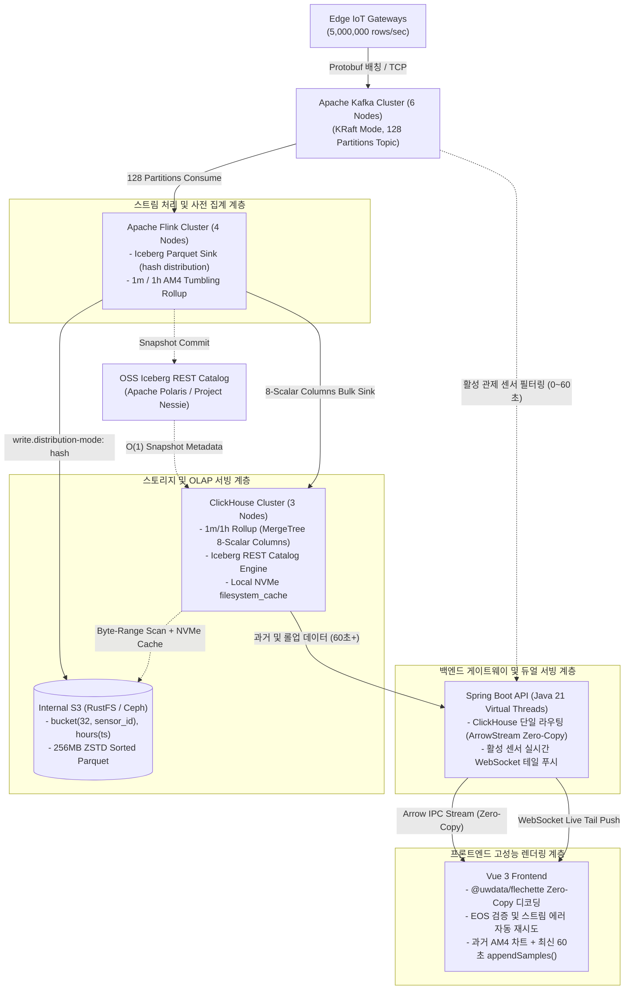

# **ADR-001: 500만 IoT 센서 1초 주기 데이터의 Parquet 적재 및 초고속 시계열 시각화 아키텍처**

> * **상태 (Status)**: 확정 (Accepted)  
> * **최종 수정일 (Updated Date)**: 2026-10-24  
> * **의사결정 범위**: 데이터 수집/스트림 처리 파이프라인, 레이크하우스 스토리지 및 OLAP 서빙 계층, 듀얼 서빙 API 게이트웨이(Spring Boot), 웹 프론트엔드(Vue 3) 고성능 시계열 렌더링 파이프라인

---

## **1. 배경 및 문제 정의 (Context & Problem Statement)**

본 시스템은 **500만 개($5 \times 10^6$) 이상의 IoT 센서**로부터 **1초 주기**로 발생하는 시계열 데이터를 유실 없이 수집하여 **Apache Parquet 포맷**으로 영구 보존하고, 웹 프론트엔드(Vue.js)에서 **최소 10개 이상의 센서에 대해 1개월(30일) 구간**을 즉시 조회하여 60fps 무지연 시계열 차트로 렌더링해야 한다.

### **1.1. 정량적 워크로드 규모**

> * **초당 인입량 (Ingestion Rate)**: $5,000,000\text{ rows/sec}$ (일간 $4.32 \times 10^{11}\text{ rows}$, 월간 $1.296 \times 10^{13}\text{ rows}$)  
> * **Parquet 스토리지 요구량**: ZSTD 압축 및 사전 인코딩 적용 시 행당 약 $2.73\text{ Bytes}$ 소요 $\rightarrow$ **일간 약 $1.18\text{ TB}$, 월간(30일) 약 $35.36\text{ TB}$** 순증  
> * **1개월 조회 시 대상 원본 포인트 수**: 10개 센서 $\times 2,592,000\text{초(30일)} = 25,920,000\text{ points}$

### **1.2. 핵심 제약 사항 (Constraints)**

> 1. **100% 오픈소스(OSS) 백엔드/DB**: 데이터베이스, 스트림 처리 엔진, 스토리지 계층은 상용 엔터프라이즈 라이선스가 필요 없는 순수 오픈소스(Apache 2.0 / MIT 등) 솔루션만 사용한다.  
> 2. **퍼블릭 클라우드 S3 사용 불가**: AWS S3를 직접 사용할 수 없으므로, **온프레미스 고속 로컬 NVMe 디스크**와 **내부 구축형 S3 호환 오브젝트 스토리지(RustFS / Ceph RGW)**만으로 구성한다.  
> 3. **API 서비스 프레임워크**: 백엔드 API, 쿼리 라우팅 및 듀얼 서빙 계층은 Spring Boot 3.4+ (Java 21 Virtual Threads)를 사용한다.  
> 4. **시계열 다운샘플링 알고리즘**: 서버 사이드 픽셀 무손실 압축 알고리즘은 단일 스캔 기반의 AM4 (Aggregation-based M4)로 단일화한다.  
> 5. **역직렬화 및 전송 프로토콜**: JSON 직렬화 병목을 제거하기 위해 **Apache Arrow IPC Stream**과 프론트엔드 **@uwdata/flechette** 기반의 Zero-Copy 역직렬화를 적용한다.  
> 6. **프론트엔드 차트 엔진**: 기보유 중인 상용 라이선스인 LightningChart JS (WebGL 하드웨어 가속 및 ZoomBandChart 내장)를 Vue 3 환경에 통합한다.

---

## **2. 검토된 대안 및 비교 (Considered Options)**

오픈소스 라이선스 제약 하에서 다음 세 가지 엔진 및 아키텍처를 비교 검토하였다.

| 비교 항목 | 대안 1: InfluxDB 3.0 Core (OSS) | 대안 2: QuestDB 9.x (Apache 2.0 OSS) | 대안 3: 하이브리드 티어드 레이크하우스 (채택) |
| :--- | :--- | :--- | :--- |
| **핵심 구성** | InfluxDB 3.0 Core 단독 | QuestDB 9.x (로컬 NVMe RAID) | **Kafka + Flink(Rollup & Iceberg) + Polaris Catalog + ClickHouse (NVMe Cache) + Spring Boot** |
| **라이선스** | MIT / Apache 2.0 | Apache 2.0 | **Apache 2.0 (전 컴포넌트 순수 OSS)** |
| **Parquet 컴팩션** | **불가** (Gen1 10분 파일만 생성, 백그라운드 컴팩터 부재) | 로컬 디스크 내 파티션 Parquet 변환 지원 | **완벽 지원** (Flink/Iceberg 기반 256MB 정렬 컴팩션) |
| **온프레미스 S3 연동** | 지원하나 컴팩션 부재로 조회 불능 | **불가** (S3 Cold Tiering은 Enterprise 전용) | **완벽 지원** (RustFS / Ceph RGW 연동 및 Polaris REST Catalog) |
| **1개월(30일) 조회** | **불가** (72시간 / 432개 파일 스캔 하드 캡) | 가능하나 월 35TB 전체를 고가 로컬 NVMe에 유지 필요 | **최상** (장기 구간은 NVMe 스칼라 롤업, 상세 확대는 Iceberg Parquet) |
| **AM4 & Arrow IPC** | Flight SQL 지원 | PGWire/REST 위주 (네이티브 Arrow 스트림 부재) | **FORMAT ArrowStream 및 C++ 벡터화 집계 완벽 지원** |

> * **InfluxDB 3.0 Core 배제 사유**: 오픈소스 Core 버전에는 백그라운드 컴팩터가 제거되어 있으며, 단일 쿼리당 스캔 파일 수 제한(432개, 72시간)으로 인해 1개월 구간 조회가 구조적으로 불가능하다.  
> * **QuestDB 9.x (OSS) 보류 사유**: 고속 인입 성능은 우수하나, 오픈소스 버전에서는 내부 S3 오브젝트 스토리지로의 Cold Tiering(`TO REMOTE`) 기능이 상용 엔터프라이즈 전용으로 제한되어 있어 월 35TB씩 증가하는 데이터를 감당하기 위한 스토리지 TCO가 과도하다.

---

## **3. 최종 아키텍처 결정 사항 (Decision Outcome)**

대안 3 (하이브리드 티어드 레이크하우스 & 듀얼 서빙 아키텍처)을 최종 아키텍처로 채택한다.

### **3.1. 계층별 확정 기술 스택**

> 1. **수집 브로커 계층: Apache Kafka 3.8+ (KRaft 모드)**  
>    * 엣지 게이트웨이에서 1초 단위로 배칭된 Protobuf 메시지를 128 파티션 단일 토픽으로 수신한다.  
> 2. **스트림 처리 및 롤업 생성 계층: Apache Flink 1.20+**  
>    * Kafka 스트림을 단독 컨슘하여 다음 두 가지 역할을 동시에 수행한다:  
>      * **Iceberg Sink**: `bucket(32, sensor_id), hours(ts)` 파티셔닝 및 `write.distribution-mode: hash` 옵션을 적용하여 내부 S3에 ZSTD 압축 256MB Parquet 파일로 정렬 적재.  
>      * **AM4 사전 롤업 생성**: Flink 텀블링 윈도우에서 1분/1시간 단위로 AM4 4쌍 핵심 값(`first_ts, first_val, min_val_ts, min_val, max_val_ts, max_val, last_ts, last_val`)을 계산하여 ClickHouse로 벌크 싱크.  
> 3. **레이크하우스 메타데이터 계층: OSS Iceberg REST Catalog (Apache Polaris / Project Nessie)**  
>    * S3 파일 경로 기반의 메타데이터 크롤링 병목을 차단하고, Flink의 스냅샷 커밋 및 ClickHouse의 테이블 메타데이터 인식을 $O(1)$의 REST API로 즉시 교환한다.  
> 4. **스토리지 및 OLAP 서빙 계층: ClickHouse 24.8 LTS+ & 내부 S3 (RustFS / Ceph RGW)**  
>    * **스칼라 8컬럼 MergeTree**: Flink로부터 받은 1분/1시간 롤업 데이터를 독점 바이너리 상태가 아닌 순수 스칼라 컬럼 구조의 `MergeTree`에 보관하여 버전 호환성을 보장하고 초고속 집계를 수행한다.  
>    * **Iceberg REST Catalog 엔진 및 로컬 NVMe 캐시**: ClickHouse 내 `Iceberg` 테이블 엔진을 REST Catalog와 연동하며, S3 Parquet 바이트레인지 스캔 결과를 로컬 NVMe `filesystem_cache`에 캐싱하여 줌/패닝 시 50~180ms 이내 응답을 보장한다.  
> 5. **백엔드 쿼리 라우팅 및 듀얼 서빙 계층: Spring Boot 3.4+ (Java 21 Virtual Threads)**  
>    * 모든 과거 시계열 조회는 ClickHouse 단일 엔진으로 라우팅하며, `FORMAT ArrowStream` 바이너리를 `StreamingResponseBody`를 통해 클라이언트로 **Zero-Copy Pass-Through** 스트리밍한다.  
>    * 사용자가 관제 중인 활성 센서의 최근 0~60초 초단위 실시간 텔레메트리는 Kafka에서 필터링하여 **WebSocket / SSE로 클라이언트에 직접 푸시**한다.  
> 6. **프론트엔드 시각화 계층: Vue 3 + @uwdata/flechette + LightningChart JS**  
>    * Arrow IPC 바이너리를 Flechette로 디코딩하여 Zero-Copy 뷰(`Uint32Array`, `Float64Array`)를 획득하고 LightningChart WebGL 버퍼에 직접 주입한다.  
>    * 스트림 무결성 검증(Arrow EOS 0xFFFFFFFF 마커 체크) 및 미드스트림 오류 시 자동 재시도 핸들러를 내장한다.  
>    * 하단 ZoomBandChart로 1개월 전체 윤곽을 표시하고, 실시간 스트리밍 포인트는 `PointLineAreaSeries.appendSamples()`로 덧붙여 무지연 실시간 관제를 달성한다.

---

## **4. 핵심 물리 스키마 및 쿼리 라우팅 명세 (Technical Specifications)**

### **4.1. 스마트 듀얼 라우팅 규칙 (Spring Boot)**

| 조회 구간 ($\Delta T = \text{ub} - \text{lb}$) | 라우팅 대상 및 경로 | 처리 방식 | 목표 응답/지연 시간 |
| :--- | :--- | :--- | :--- |
| **최근 실시간 (0 ~ 60초)** | **Spring Boot WebSocket Live Tail** | Kafka 필터링 $\rightarrow$ WebSocket 푸시 $\rightarrow$ LC JS `appendSamples()` | **< 100 ms (Live Push)** |
| **초단위 상세 확대 (60초 < $\Delta T \le 2W\text{초}$)** | **iot.sensor_iceberg_raw** (ClickHouse) | 다운샘플링 없이 원본 1초 데이터 반환 (NVMe 캐시 활용) | **50 ~ 120 ms** |
| **고해상도 AM4 (2W초 < $\Delta T \le 6\text{시간}$)** | **iot.sensor_iceberg_raw** (ClickHouse) | 원본 Parquet 상에서 단일 스캔 AM4 수행 | **80 ~ 160 ms** |
| **중간 확대 (6시간 < $\Delta T \le 7\text{일}$)** | **iot.sensor_rollup_1m** (ClickHouse) | 1분 스칼라 8컬럼 기반 픽셀 단위 AM4 2차 집계 | **15 ~ 35 ms** |
| **장기 전체 윤곽 ($\Delta T > 7\text{일}$, 1개월 등)** | **iot.sensor_rollup_1h** (ClickHouse) | 1시간 스칼라 8컬럼 기반 픽셀 단위 AM4 2차 집계 | **10 ~ 25 ms** |

---

### **4.2. ClickHouse 스키마 DDL (스칼라 8컬럼 MergeTree)**

Flink에서 사전 집계된 롤업 데이터를 적재하는 1분 롤업 테이블 명세:

```sql
-- 1분 AM4 스칼라 사전 집계 테이블
CREATE TABLE iot.sensor_rollup_1m (
    sensor_id   UInt32,
    bucket_ts   DateTime('UTC'),
    first_ts    DateTime64(3, 'UTC'),
    first_val   Float64,
    min_val_ts  DateTime64(3, 'UTC'),
    min_val     Float64,
    max_val_ts  DateTime64(3, 'UTC'),
    max_val     Float64,
    last_ts     DateTime64(3, 'UTC'),
    last_val    Float64
) ENGINE = MergeTree()
PARTITION BY toYYYYMM(bucket_ts)
ORDER BY (sensor_id, bucket_ts)
SETTINGS index_granularity = 8192;
```

---

### **4.3. 표준 AM4 쿼리 명세 (스칼라 롤업 대상 ArrowStream 출력)**

화면 픽셀 폭(`:width`)과 시간 범위(`:lb_sec`, `:ub_sec`)에 맞춰 단일 스캔으로 픽셀당 4점을 추출하는 표준 쿼리:

```sql
SELECT
    toUInt32(sensor_id) AS sensor_id,
    toFloat64(point.1)  AS ts_ms,
    toFloat64(point.2)  AS val
FROM (
    SELECT
        sensor_id,
        round(:width * (toUnixTimestamp(bucket_ts) - :lb_sec) / (:ub_sec - :lb_sec)) AS pixel_bin,
        arrayDistinct(arraySort(x -> x.1, [
            (toUnixTimestamp64Milli(min(first_ts)),   argMin(first_val, first_ts)),
            (toUnixTimestamp64Milli(argMin(min_val_ts, min_val)), min(min_val)),
            (toUnixTimestamp64Milli(argMax(max_val_ts, max_val)), max(max_val)),
            (toUnixTimestamp64Milli(max(last_ts)),    argMax(last_val, last_ts))
        ])) AS am4_points
    FROM iot.sensor_rollup_1m
    WHERE sensor_id IN (:sensor_ids)
      AND bucket_ts >= toDateTime(:lb_sec)
      AND bucket_ts <= toDateTime(:ub_sec)
    GROUP BY sensor_id, pixel_bin
)
ARRAY JOIN am4_points AS point
ORDER BY sensor_id ASC, ts_ms ASC
FORMAT ArrowStream;
```

---

## **5. 인프라 사이징 및 권장 사양 (Infrastructure Sizing)**

초당 500만 건 인입 및 35.36 TB/월 적재를 위한 계층별 권장 노드 사양:

| 컴포넌트 레이어 | 노드 수 (Scale) | 노드당 권장 사양 (CPU / RAM / Disk) | 핵심 역할 및 사이징 근거 |
| :--- | :--- | :--- | :--- |
| **Apache Kafka** | **6 Nodes** | 16 vCPU / 64 GB RAM / 2 TB NVMe (RAID 10) | 128 파티션 단일 토픽 수신, 엣지 배칭 메시지 버퍼링 |
| **Apache Flink** | **4 Nodes** | 32 vCPU / 128 GB RAM / 1 TB NVMe | Iceberg Parquet 해시 싱크(60초 커밋) 및 1m/1h AM4 롤업 사전 연산 |
| **Iceberg REST Catalog (Polaris)** | **2 Nodes** | 4 vCPU / 16 GB RAM / 100 GB SSD | 무상태(Stateless) 컨테이너, $O(1)$ 스냅샷 메타데이터 동기화 |
| **Internal S3 (RustFS / Ceph)** | **4+ Nodes** | 16 vCPU / 64 GB RAM / **48 TB+ High-Density HDD/SSD** | 월 35.36 TB 원본 Parquet 장기 보존 (Erasure Coding) |
| **ClickHouse (OLAP)** | **3 Nodes** | 32 vCPU / 128 GB RAM / **4 TB U.3 NVMe** | 1m/1h 롤업 서빙, Iceberg 연동 쿼리 및 `filesystem_cache` 운영 |
| **Spring Boot API** | **3 Nodes** | 8 vCPU / 32 GB RAM / 100 GB SSD | 가상 스레드 기반 쿼리 스트리밍 및 활성 센서 WebSocket 테일 푸시 |

---

## **6. 최종 아키텍처 노드 구성도 (Topology & Data Flow)**



---

## **7. 기대 효과 및 운영 리스크 완화 방안 (Consequences & Mitigations)**

### **7.1. 긍정적 효과 (Positive Consequences)**

> * **순수 100% 오픈소스 TCO 절감**: 모든 계층(Kafka, Flink, Polaris, ClickHouse, S3)을 상용 라이선스 제약 없이 영구적으로 확장할 수 있다.  
> * **ClickHouse 인입 부하 98% 격감**: 500만 건/초의 실시간 파싱 및 집계 부담을 Flink 윈도우 파이프라인으로 이관하여 ClickHouse의 안정성을 극대화하였다.  
> * **I/O 프루닝 극대화**: 32 해시 버킷 복합 파티셔닝을 통해 10개 센서 조회 시 S3 파일 스캔 범위를 $\frac{1}{32}$ 이하로 억제하였다.  
> * **초단위 실시간 관제와 대량 과거 조회의 완벽한 분리**: WebSocket 라이브 테일과 ClickHouse OLAP 서빙을 결합하여, Flink 60초 체크포인트로 인한 지연 공백을 완전히 해소하였다.

### **7.2. 운영 리스크 및 완화 방안 (Mitigations)**

> * **Iceberg 소형 파일 난립 방지**: Flink 파이프라인에 `write.distribution-mode: hash`와 `keyBy(sensor_id % 32)`를 강제하여 버킷별 전담 싱크 라이터가 256MB 정렬 파일을 생성하도록 보장한다.  
> * **S3 메타데이터 크롤링 지연 완화**: 파일 경로 탐색을 배제하고 경량 OSS REST Catalog(Polaris)를 배치하여 ClickHouse가 스냅샷 메타데이터를 $O(1)$로 참조하게 한다.  
> * **Zero-Copy 스트리밍 중단(Mid-stream Error) 대응**: 프론트엔드 `@uwdata/flechette` 수신부에 Arrow EOS 마커(0xFFFFFFFF) 검증 및 지수 백오프(Exponential Backoff) 재시도 로직을 탑재하여 통신 불안정에 대응한다.  
> * **차트 줌 이벤트 무한 루프 차단**: Vue 3 컴포저블에 `isProgrammaticUpdate` 가드와 `AbortController`를 배치하여 시리즈 갱신 도중 이벤트 재발화를 방지하고 미완료 요청을 즉시 취소한다.
