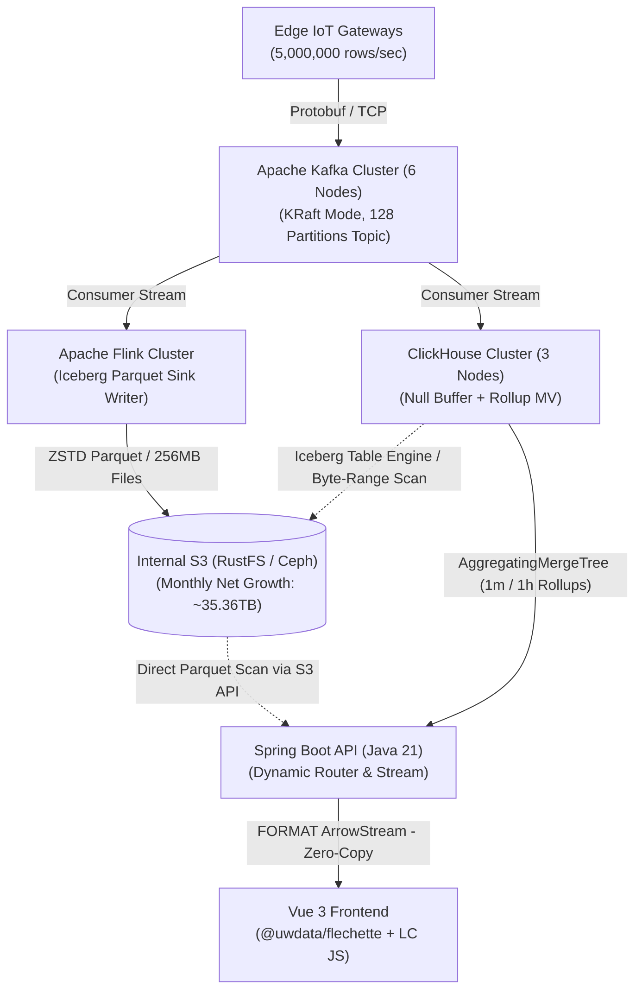

# **ADR-001: 500만 IoT 센서 1초 주기 데이터의 Parquet 적재 및 초고속 시계열 시각화 아키텍처**

> * **상태 (Status)**: 확정 (Accepted)  
> * **작성일 (Date)**: 2026-10-23  
> * **의사결정 범위**: 데이터 수집/저장 백엔드, 쿼리 라우팅 API 서버(Spring Boot), 웹 프론트엔드(Vue 3\) 시각화 파이프라인

## **1\. 배경 및 문제 정의 (Context & Problem Statement)**

본 시스템은 **500만 개(5 \\times 10^6) 이상의 IoT 센서**로부터 **1초 주기**로 발생하는 시계열 데이터를 유실 없이 수집하여 **Apache Parquet 포맷**으로 영구 보존하고, 웹 프론트엔드(Vue.js)에서 **최소 10개 이상의 센서에 대해 1개월(30일) 구간**을 즉시 조회하여 시계열 차트로 렌더링해야 한다.

### **1.1. 정량적 워크로드 규모**

> * **초당 인입량 (Ingestion Rate)**: 5,000,000\\text{ rows/sec} (일간 4.32 \\times 10^{11}\\text{ rows}, 월간 1.296 \\times 10^{13}\\text{ rows})  
> * **Parquet 스토리지 요구량**: ZSTD 압축 및 사전 인코딩 적용 시 행당 약 2.73\\text{ Bytes} 소요 \\rightarrow **일간 약 1.18\\text{ TB}, 월간(30일) 약 35.36\\text{ TB}** 증가  
> * **1개월 조회 시 대상 원본 포인트 수**: 10개 센서 \\times 2,592,000\\text{초(30일)} \= 25,920,000\\text{ points}

### **1.2. 핵심 제약 사항 (Constraints)**

> 1. **상용 라이선스 배제 (백엔드/DB)**: 데이터베이스, 스트림 처리, 스토리지 계층은 상용 엔터프라이즈 라이선스가 필요 없는 **100% 오픈소스(OSS)** 솔루션만 사용한다.  
> 2. **퍼블릭 클라우드 S3 사용 불가**: AWS S3를 직접 사용할 수 없으므로, **온프레미스 로컬 NVMe 디스크**와 **내부 구축형 S3 호환 오브젝트 스토리지**만으로 구성해야 한다.  
> 3. **API 서비스 프레임워크**: 백엔드 API 및 쿼리 라우팅 계층은 Spring Boot (Java 21)를 사용한다.  
> 4. **시계열 다운샘플링 알고리즘**: 서버 사이드 픽셀 무손실 압축 알고리즘은 단일 스캔 기반의 AM4 (Aggregation-based M4)로 단일화한다.  
> 5. **역직렬화 및 전송 프로토콜**: JSON 직렬화 병목을 제거하기 위해 **Apache Arrow IPC Stream**과 프론트엔드 **@uwdata/flechette** 기반의 Zero-Copy 역직렬화를 적용한다.  
> 6. **프론트엔드 차트 엔진**: 기보유 중인 상용 라이선스인 LightningChart JS (WebGL 하드웨어 가속 및 ZoomBandChart 내장)를 Vue 3 환경에 통합한다.

## **2\. 검토된 대안 및 배제 사유 (Considered Options)**

오픈소스 라이선스 제약 하에서 다음 세 가지 엔진 및 아키텍처를 비교 검토하였다.

| 비교 항목 | 대안 1: InfluxDB 3.0 Core (OSS) | 대안 2: QuestDB 9.x (Apache 2.0 OSS) | 대안 3: 하이브리드 티어드 레이크하우스 (채택) |
| :---- | :---- | :---- | :---- |
| **핵심 구성** | InfluxDB 3.0 Core 단독 | QuestDB 9.x (로컬 NVMe RAID) | **ClickHouse (NVMe 롤업) \+ Flink/Iceberg (내부 S3 Parquet)** |
| **라이선스** | MIT / Apache 2.0 | Apache 2.0 | Apache 2.0 (전 컴포넌트 순수 OSS) |
| **Parquet 컴팩션** | **불가** (Gen1 10분 파일만 생성, 컴팩터 부재) | 로컬 디스크 내 파티션 Parquet 변환 지원 | **완벽 지원** (Flink/Iceberg 기반 256\\text{ MB} 정렬 컴팩션) |
| **온프레미스 S3 연동** | 지원하나 컴팩션 불가로 조회 불능 | **불가** (S3 Cold Tiering은 Enterprise 전용) | **완벽 지원** (RustFS / Ceph RGW 내부 S3 연동) |
| **1개월(30일) 조회** | **불가** (72시간 / 432개 파일 스캔 하드 캡) | 가능하나 35\\text{ TB+} 전체를 로컬 NVMe에 유지 필요 | **최상** (장기 구간은 NVMe 롤업, 상세 확대는 Iceberg Parquet) |
| **AM4 & Arrow IPC** | Flight SQL 지원 | PGWire/REST 위주 (네이티브 Arrow 스트림 부재) | **argMin/argMax 및 FORMAT ArrowStream 네이티브 지원** |

> * **InfluxDB 3.0 Core 배제 사유**: 오픈소스 Core 버전에는 백그라운드 컴팩터(Compactor)가 제거되어 있으며, 쿼리당 최대 스캔 파일 수가 432개(72시간)로 제한되어 있어 1개월 조회가 구조적으로 불가능하다.  
> * **QuestDB 9.x (OSS) 보류 사유**: 9.x 버전에서 동적 심볼 맵과 로컬 Parquet 변환 기능이 크게 향상되었으나, 오픈소스 버전에서는 내부 S3 오브젝트 스토리지로의 Cold Tiering(TO REMOTE)과 네이티브 분산 클러스터링이 제외되어 있어 월 $35TB$씩 증가하는 데이터를 무한 확장하기에 인프라 비용 부담이 크다.

## **3\. 최종 아키텍처 결정 사항 (Decision Outcome)**

대안 3 (하이브리드 티어드 레이크하우스: Kafka \+ Flink/Iceberg on Internal S3 \+ ClickHouse Local NVMe Rollup \+ Spring Boot \+ Vue 3 / Flechette / LightningChart JS)을 최종 아키텍처로 채택한다.

### **3.1. 계층별 확정 기술 스택**

> 1. **수집 브로커 계층**: **Apache Kafka 3.8+ (KRaft 모드)**  
   * 엣지 게이트웨이에서 1초 단위로 배칭된 Protobuf 메시지를 128 Partitions 토픽으로 수신한다.  
> 2. **Cold/Raw Parquet 레이크하우스 계층**: **Apache Flink 1.20+ & Apache Iceberg 1.7+ on 내부 S3 (RustFS 또는 Ceph RGW)**  
   * 퍼블릭 S3 대신 내부 25\\text{GbE} 네트워크에 구축된 **RustFS**(Apache 2.0) 또는 **Ceph RGW** 오브젝트 스토리지를 사용한다.  
   * Flink가 스트림을 소비하여 Iceberg 테이블에 **ZSTD 압축 Parquet 포맷**으로 적재한다.  
   * 특정 센서 조회 시 I/O 프루닝을 극대화하기 위해 파티션은 hours(ts), 파일 내부 정렬은 sensor\_id ASC, ts ASC, 타겟 파일 크기는 $256MB$로 유지하며 sensor\_id 컬럼에 Parquet Bloom Filter를 활성화한다.  
> 3. **Hot Rollup 및 통합 쿼리 엔진 계층**: **ClickHouse 24.8 LTS+**  
   * **로컬 NVMe 디스크 절약 (Null 테이블 엔진 활용)**: ClickHouse는 1초 원본 데이터를 로컬 NVMe에 중복 저장하지 않고 ENGINE \= Null 인입 버퍼 테이블로만 통과시킨다.  
   * **실시간 AM4 상태 롤업 (AggregatingMergeTree)**: 데이터가 인입되는 즉시 실시간 구체화 뷰(Materialized View)를 통해 **1분 단위(sensor\_rollup\_1m)** 및 **1시간 단위(sensor\_rollup\_1h)** 사전 집계 테이블을 생성하여 로컬 NVMe에 보관한다. 각 버킷은 AM4 계산에 필요한 4점 상태(minState(ts), argMinState(val, ts), maxState(ts), argMaxState(val, ts), argMinState(ts, val), minState(val), argMaxState(ts, val), maxState(val))를 보존한다.  
   * **Iceberg Parquet 통합 조회**: 사용자가 초 단위로 줌인(Zoom-in)할 때는 ClickHouse의 Iceberg 테이블 엔진을 통해 내부 S3의 원본 Parquet 파일을 Byte-range 요청으로 직접 스캔한다.  
> 4. **API 및 쿼리 라우팅 계층**: **Spring Boot 3.4+ (Java 21 Virtual Threads)**  
   * 프론트엔드가 요청한 시간 범위(\\Delta T \= \\text{ub} \- \\text{lb})와 화면 가로 픽셀 수(W)를 기반으로 최적의 대상 테이블을 자동 선택한다.  
   * ClickHouse가 반환하는 FORMAT ArrowStream 바이너리를 JVM 힙 객체(List\<Dto\>)로 역직렬화하지 않고, StreamingResponseBody를 사용해 **InputStream \\rightarrow HTTP OutputStream으로 Zero-Copy Pass-Through** 스트리밍한다.  
> 5. **프론트엔드 시각화 계층**: **Vue 3 \+ @uwdata/flechette \+ LightningChart JS**  
   * 브라우저가 수신한 Arrow IPC ArrayBuffer를 @uwdata/flechette의 tableFromIPC()로 디코딩하여 복사 없이 Uint32Array(sensor\_id)와 Float64Array(ts\_ms, val) 메모리 뷰를 획득한다.  
   * SQL 단계에서 ORDER BY sensor\_id ASC, ts\_ms ASC로 정렬된 배열에 대해 TypedArray.subarray(start, end) 오프셋 슬라이싱을 수행하여, LightningChart JS의 PointLineAreaSeries.appendSamples({ xValues, yValues })에 직접 주입한다.  
   * 하단에는 LightningChart JS 내장 ZoomBandChart를 배치하여 1개월 전체 윤곽을 상시 표시하고, 상단 차트 확대/이동(onIntervalChange, 120ms 디바운스) 시 해당 구간의 고해상도 AM4 데이터를 동적으로 재요청(Semantic Zoom)한다.

## **4\. 핵심 물리 스키마 및 쿼리 라우팅 명세 (Technical Specifications)**

### **4.1. 스마트 쿼리 라우팅 규칙 (Spring Boot \\rightarrow ClickHouse)**

| 조회 구간 (\\Delta T \= \\text{ub} \- \\text{lb}) | 라우팅 대상 테이블 (스토리지) | 동작 방식 | 목표 응답 시간 |
| :---- | :---- | :---- | :---- |
| **\\Delta T \> 7\\text{일}** (1개월 전체 윤곽 등) | iot.sensor\_rollup\_1h (로컬 NVMe) | 1시간 AM4 상태 병합 (\*Merge) | **10 \\sim 25\\text{ ms}** |
| **6\\text{시간} \< \\Delta T \\le 7\\text{일}** (중간 확대) | iot.sensor\_rollup\_1m (로컬 NVMe) | 1분 AM4 상태 병합 (\*Merge) | **20 \\sim 45\\text{ ms}** |
| **2W\\text{초} \< \\Delta T \\le 6\\text{시간}** (상세 확대) | iot.sensor\_iceberg\_raw (내부 S3 Parquet) | 1초 원본 Parquet 상에서 단일 스캔 AM4 수행 | **80 \\sim 180\\text{ ms}** |
| **\\Delta T \\le 2W\\text{초}** (초 단위 극한 확대) | iot.sensor\_iceberg\_raw (내부 S3 Parquet) | 다운샘플링 없이 1초 단위 원본 그대로 반환 | **50 \\sim 120\\text{ ms}** |

### **4.2. 표준 AM4 단일 스캔 쿼리 및 타입 고정 규칙**

프론트엔드 @uwdata/flechette에서 단일/다중 RecordBatch 여부에 관계없이 항상 일정한 TypedArray(Uint32Array, Float64Array)를 얻도록 SELECT 절 최상단에서 명시적 타입 캐스팅을 강제한다.  
`-- 롤업 테이블(1m / 1h) 대상 AM4 추출 및 Arrow IPC 스트림 출력 표준 쿼리`  
`SELECT`  
    `toUInt32(sensor_id) AS sensor_id,`  
    `toFloat64(point.1) AS ts_ms,`  
    `toFloat64(point.2) AS val`  
`FROM (`  
    `SELECT`  
        `sensor_id,`  
        `round(:width * (toUnixTimestamp(bucket_ts) - :lb_sec) / (:ub_sec - :lb_sec)) AS pixel_bin,`  
        `arrayDistinct(arraySort(x -> x.1, [`  
            `(toUnixTimestamp64Milli(minMerge(first_ts)), argMinMerge(first_val)),`  
            `(toUnixTimestamp64Milli(argMinMerge(min_val_ts)), minMerge(min_val)),`  
            `(toUnixTimestamp64Milli(argMaxMerge(max_val_ts)), maxMerge(max_val)),`  
            `(toUnixTimestamp64Milli(maxMerge(last_ts)), argMaxMerge(last_val))`  
        `])) AS am4_points`  
    `FROM iot.sensor_rollup_1m`  
    `WHERE sensor_id IN (:sensor_ids)`  
      `AND bucket_ts >= toDateTime(:lb_sec)`  
      `AND bucket_ts <= toDateTime(:ub_sec)`  
    `GROUP BY sensor_id, pixel_bin`  
`)`  
`ARRAY JOIN am4_points AS point`  
`ORDER BY sensor_id ASC, ts_ms ASC`  
`FORMAT ArrowStream;`

## **5\. 인프라 사이징 및 권장 하드웨어 사양 (Infrastructure Sizing & Hardware Specs)**

초당 500만 건 인입(5M msgs/sec) 및 월간 35.36 TB 적재 기준을 충족하기 위한 컴포넌트별 권장 프로덕션 하드웨어 사양입니다.

| 컴포넌트 레이어 | 노드 수 (Scale) | 노드당 권장 사양 (CPU / RAM / Disk) | 핵심 역할 및 사이징 근거 |
| :---- | :---- | :---- | :---- |
| **Apache Kafka** | **6 Nodes** | 16 vCPU / 64 GB RAM / 2 TB NVMe (RAID 10\) | 128 파티션 수신, 1초 마이크로배치 버퍼링 |
| **Apache Flink** | **4 Nodes** | 32 vCPU / 128 GB RAM / 1 TB NVMe | 실시간 스트림 소비, Iceberg Parquet 변환 및 컴팩션 |
| **Internal S3 (RustFS / Ceph)** | **4+ Nodes** | 16 vCPU / 64 GB RAM / **48 TB+ High-Density HDD/SSD** | 월 35.36\\text{ TB} 원본 파켓 장기 영구 보존 (Erasure Coding) |
| **ClickHouse (OLAP)** | **3 Nodes** | 32 vCPU / 128 GB RAM / **4 TB NVMe (U.3 Enterprise)** | 로컬 1분/1시간 롤업 뷰 보관 및 Iceberg 연동 통합 쿼리 |
| **Spring Boot API** | **3 Nodes** | 8 vCPU / 32 GB RAM / 100 GB SSD | 가상 스레드 기반 쿼리 라우팅 및 Arrow IPC 스트리밍 |

## **6\. 권장 노드 구성도 (Topology & Data Flow Architecture)**

전체 시스템의 데이터 흐름과 네트워크 토폴로지 구성은 다음과 같습니다.

## **7\. 기대 효과 및 운영 시 주의사항 (Consequences & Risks)**

### **7.1. 긍정적 효과 (Positive Consequences)**

> * **라이선스 비용 Zero**: 백엔드 수집부터 레이크하우스 스토리지, OLAP 엔진까지 100% Apache 2.0 오픈소스로 구축하여 노드 확장이나 코어 증설에 따른 상용 라이선스 비용이 전혀 발생하지 않는다.  
> * **로컬 NVMe 비용 절감 및 무한 확장성**: 월 $35.36TB$씩 증가하는 원본 Parquet 데이터는 저렴한 고밀도 온프레미스 S3(RustFS/Ceph)에 저장하고, 고가의 로컬 NVMe에는 원본 대비 1/60 이하 크기인 AM4 롤업 상태만 저장하므로 스토리지 TCO가 극적으로 절감된다.  
> * **픽셀 무손실 60fps 렌더링**: AM4 알고리즘으로 전송량을 센서당 최대 4 \\times W개로 제한하고, Spring Boot Pass-Through \\rightarrow Flechette subarray \\rightarrow LightningChart WebGL 버퍼로 이어지는 전 구간 Zero-Copy 파이프라인을 통해 가비지 컬렉션(GC) 멈춤이나 프레임 드랍 없이 즉각적인 줌/패닝을 달성한다.

### **7.2. 운영 리스크 및 완화 방안 (Mitigations)**

> * **Iceberg 소형 파일 문제 (Small File Problem)**: 1초 주기로 유입되는 스트림을 그대로 커밋하면 소형 Parquet 파일이 대량 생성되어 S3 조회 성능이 저하될 수 있다.  
  * *완화 방안*: Flink 체크포인트 주기를 60\~180초로 설정하고, 백그라운드에서 Iceberg rewrite\_data\_files 정렬 컴팩션 잡을 주기적으로 실행하여 256\\text{ MB} 파일 크기와 (sensor\_id, ts) 정렬 상태를 유지한다.  
> * **리버스 프록시 스트리밍 버퍼링**: 앞단 API 게이트웨이나 Nginx가 Arrow IPC 스트림을 버퍼링하면 첫 바이트 도달 시간(TTFB)이 지연될 수 있다.  
  * *완화 방안*: /api/v1/telemetry/am4-arrow 엔드포인트에 대해 Nginx의 proxy\_buffering off; 및 Spring Boot의 enable\_http\_compression=0 설정을 의무화한다.  
> * **차트 줌 이벤트 무한 루프**: 프론트엔드에서 데이터를 갱신할 때 X축 인터벌 변경 이벤트가 재발화하여 무한 API 호출이 일어날 수 있다.  
  * *완화 방안*: Vue 3 컴포저블 내에 isProgrammaticUpdate 플래그와 AbortController를 두어 프로그래밍 방식의 시리즈 갱신 중에는 이벤트 리스너를 차단하고 이전 미완료 요청을 즉시 취소한다.