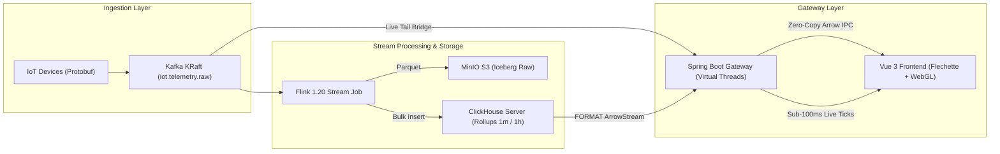

# Real-Time IoT Telemetry Ingestion & Visualization Service

High-performance real-time IoT telemetry service capable of streaming and rendering up to 5,000,000 data points smoothly using Apache Arrow, Apache Flink, ClickHouse, Apache Kafka, Spring Boot 4.x (Java 25 Virtual Threads), and Vue 3 (LightningChart JS / WebGL).

---

## Architecture Overview



- **Protobuf & Kafka KRaft**: Ingests high-frequency sensor measurements across 128 partitions with zero Zookeeper overhead.
- **Apache Flink**: Computes tumbling 1-minute and 1-hour rollups while dual-sinking raw measurements to MinIO S3 and rollups to ClickHouse.
- **ClickHouse Server**: Serves fast analytical queries with native `FORMAT ArrowStream` binary streaming directly to HTTP responses.
- **Spring Boot Gateway**: Uses Java 25 Virtual Threads and non-blocking streaming responses (`StreamingResponseBody`), routing queries between raw, 1m, and 1h rollups.
- **Dynamic Live Tail Bridge**: Filters incoming Kafka ticks with $O(1)$ early drop and dispatches to subscribed WebSocket clients.
- **Vue 3 & LightningChart JS**: Zero-copy deserialization with `@uwdata/flechette` into TypedArrays and fixed-budget circular ring buffers, rendering millions of points at 60 FPS.

---

## Quickstart (Docker Sandbox)

The entire infrastructure runs locally with zero external cloud dependencies.

1. **Build backend and frontend artifacts**:
   ```bash
   cd backend && gradle :gateway:bootJar && cd ..
   cd frontend && npm run build && cd ..
   ```

2. **Start the Docker Sandbox**:
   ```bash
   docker compose up -d --build
   ```

3. **Bootstrap and verify**:
   - On Linux/macOS: `./scripts/init-sandbox.sh && ./scripts/e2e-smoke-test.sh`
   - On Windows: `.\scripts\init-sandbox.ps1; .\scripts\e2e-smoke-test.ps1`

For complete sandbox documentation, see [docs/sandbox-guide.md](docs/sandbox-guide.md).

---

## Running Automated Tests

```bash
# Run backend tests (Spring Boot Gateway + Flink Pipeline)
cd backend
gradle test

# Run frontend tests (Vitest + Vue Test Utils)
cd ../frontend
npm test
```

---

## Documentation

- [ADR-001: 5M IoT Telemetry Architecture](docs/adr/0001-5m-iot-telemetry-architecture.md)
- [Spec 001: Walking Skeleton](docs/specs/spec-001-walking-skeleton.md)
- [Spec 002: Architecture Refactoring](docs/specs/spec-002-architecture-refactoring.md)
- [Spec 003: Production Infrastructure Binding](docs/specs/spec-003-production-infrastructure-binding.md)
- [Docker Sandbox Guide](docs/sandbox-guide.md)
- [Agent Work Log](docs/work-log.md)
