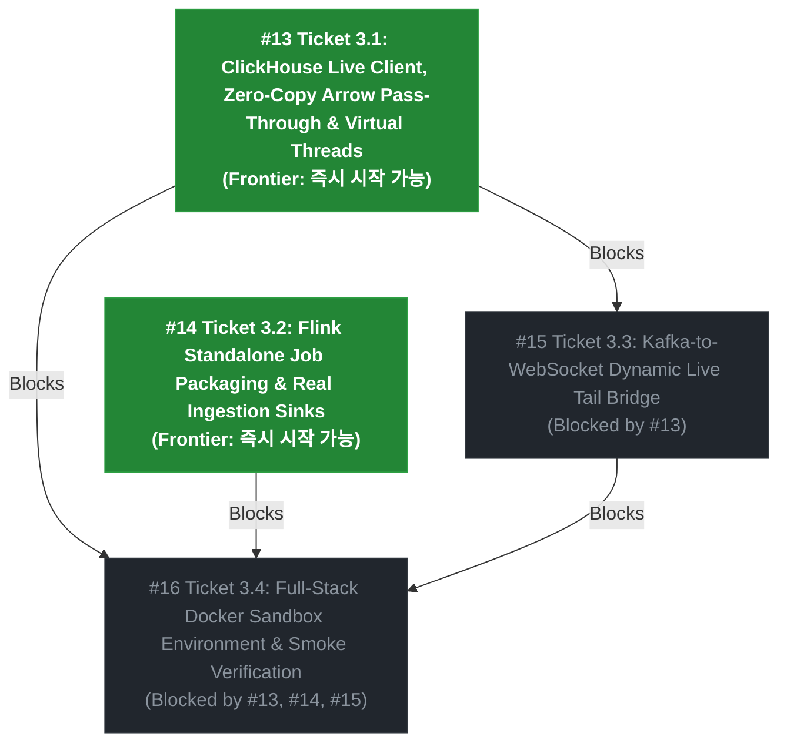

# Spec 003: Production Infrastructure Binding & Live Cluster Readiness

## Summary

This specification transitions the real-time telemetry service from an in-memory verified architectural prototype into a production-ready system directly bound to live infrastructure. Based on the gap analysis against ADR-001, this spec covers:
1. Connecting `ClickHouseArrowStorageEngine` to a live ClickHouse instance via HTTP/TCP client, enabling zero-copy binary `FORMAT ArrowStream` pass-through and activating Java 21 Virtual Threads in Spring Boot 3.4+.
2. Creating a standalone executable Flink job (`TelemetryStreamJob`) with native Kafka `KafkaSource<byte[]>`, Iceberg `IcebergSink.forRowData()`, and ClickHouse JDBC/HTTP bulk sinks.
3. Implementing a dynamic Kafka-to-WebSocket bridge that filters and pushes live ticks for active client subscriptions with sub-100ms latency.
4. Providing a local full-stack Docker Compose environment (Kafka, ClickHouse, MinIO, Flink, Gateway, and Frontend) with automated end-to-end smoke tests.

---

## User Stories

1. **As a backend developer**, I want `ClickHouseArrowStorageEngine` to pipe raw bytes directly from ClickHouse's `FORMAT ArrowStream` response into Spring Boot's `StreamingResponseBody`, so that queries never allocate intermediate Java row objects or suffer GC overhead.
2. **As an operations engineer**, I want Spring Boot to leverage Java 21 Virtual Threads for all concurrent telemetry streaming requests, so that thousands of concurrent analytical sessions can be served without thread starvation.
3. **As a stream pipeline engineer**, I want an executable `TelemetryStreamJob` JAR that can be submitted to a production Flink cluster, ingesting from a real 128-partition Kafka topic and sinking directly to S3-backed Iceberg tables and ClickHouse rollups.
4. **As a dashboard user**, I want my subscribed live sensor feeds to be streamed directly from Kafka to my browser over WebSocket with <100ms latency without polling or delays.
5. **As a QA / release engineer**, I want a one-click Docker Compose sandbox environment that boots the entire end-to-end stack locally, so that integrations can be validated continuously before production deployment.

---

## Implementation Decisions

### 1. ClickHouse Live Client & Direct Binary Pass-Through (Backend Gateway)
- Add ClickHouse official HTTP/TCP client dependency (`com.clickhouse:clickhouse-client` and `com.clickhouse:clickhouse-http-client`).
- Update `application.properties`:
  - `spring.threads.virtual.enabled=true`
  - `telemetry.clickhouse.url=http://localhost:8123`
  - `telemetry.clickhouse.database=iot`
- Refactor `ClickHouseTelemetryService` to maintain two operating modes:
  - **Live Mode**: Executes the SQL generated by `TelemetryQueryRouter` against ClickHouse HTTP endpoint, streaming the raw `InputStream` from ClickHouse directly to Spring's `OutputStream` via `StreamUtils.copy(in, out)`. Zero memory allocation.
  - **Fallback / Mock Mode**: Preserved for isolated testing without a running ClickHouse daemon.
- Provide database migration DDL (`backend/gateway/src/main/resources/db/migration/V1__init_telemetry_tables.sql`):
  - `CREATE DATABASE IF NOT EXISTS iot;`
  - `CREATE TABLE IF NOT EXISTS iot.sensor_rollup_1m ...`
  - `CREATE TABLE IF NOT EXISTS iot.sensor_rollup_1h ...`

### 2. Standalone Flink Stream Job Packaging (Data Pipeline)
- Introduce `com.telemetry.pipeline.TelemetryStreamJob` containing `public static void main(String[] args)`.
- Configure `KafkaSource.<byte[]>builder()` pointing to configured Kafka bootstrap servers, topic `iot.telemetry.raw`, 128 partitions, and Earliest/Latest offset strategy.
- Connect `TelemetryPipelineTopology.buildTopology(env, stream)` to live sinks:
  - Iceberg Sink: uses `IcebergSink.forRowData()` configured with S3 FileIO (`s3://telemetry-warehouse/iot/sensor_iceberg_raw`).
  - ClickHouse Sink: uses Flink's JDBC sink / ClickHouse bulk writer.
- Add packaging task in `backend/pipeline/build.gradle.kts` to build a shaded Flink Fat-JAR.

### 3. Kafka-to-WebSocket Dynamic Live Tail Bridge (Ingress & Gateway)
- Implement `TelemetryLiveTailConsumer` using Spring Kafka (`@KafkaListener` or programmatic `KafkaConsumer`).
- Dynamically subscribe/filter based on active client subscriptions maintained in `TelemetryWebSocketHandler`.
- Forward incoming matching ticks directly to active WebSocket sessions using non-blocking queues, ensuring <100ms delivery.

### 4. Full-Stack Docker Sandbox Environment (Infrastructure & E2E)
- Create `docker-compose.yml` in repository root:
  - `kafka`: KRaft mode (no Zookeeper), port 9092
  - `clickhouse`: ClickHouse Server 24.8 LTS with port 8123 (HTTP) and 9000 (Native)
  - `minio`: S3-compatible local object storage with port 9000 (API) and 9001 (Console)
  - `flink-jobmanager` & `flink-taskmanager`: Apache Flink 1.20
  - `gateway`: Spring Boot 3.4+ service (port 8080)
  - `frontend`: Vite Vue 3 dev/prod server (port 5173)
- Provide initialization script `scripts/init-sandbox.sh` / `scripts/init-sandbox.ps1` to bootstrap buckets and create ClickHouse tables.
- Add automated end-to-end smoke test script `scripts/e2e-smoke-test.sh` / `scripts/e2e-smoke-test.ps1`.

---

## Testing Decisions

- **Gateway Live Engine**:
  - Integration test verifying `ClickHouseArrowStorageEngine` streams live byte streams when ClickHouse is available, and falls back gracefully when disabled.
  - Verify Java 21 Virtual Thread executor is active on Spring WebMvc task execution.
- **Flink Pipeline Job**:
  - Verify `TelemetryStreamJob` parameter parsing and execution graph generation without errors.
- **WebSocket Bridge**:
  - Test multi-client subscription filtering: client subscribing to sensor 1 receives only sensor 1 ticks, ignoring ticks for sensor 2.
- **Full-Stack Smoke Test**:
  - Script that posts a synthetic Protobuf message to Kafka, verifies it appears in ClickHouse 1m rollups, and verifies HTTP `am4-arrow` and WebSocket `/ws/v1/telemetry/live` return valid Arrow/JSON streams.

---

## Out of Scope

- Setting up production multi-DC Kafka clusters across AWS/GCP (remains on-prem / local container architecture).
- Commercial enterprise license components (QuestDB Enterprise, InfluxDB Enterprise).
- Proprietary monitoring agents.

---

## Ticket Graph & Milestones

