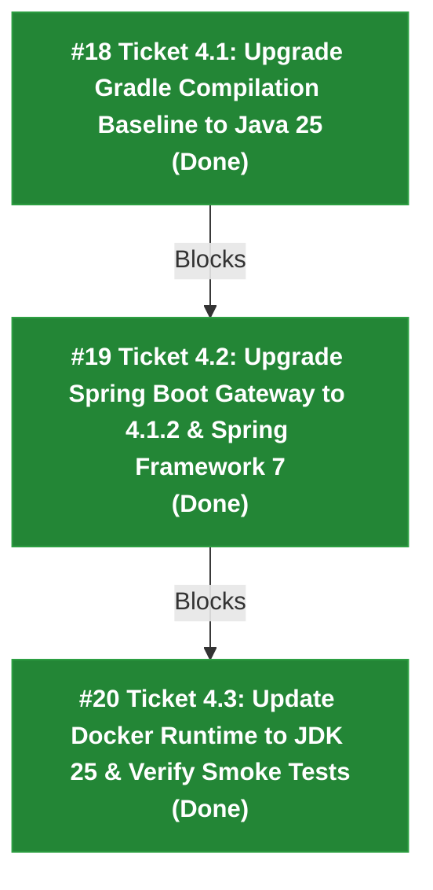

# Spec 004: JDK 25 & Spring Boot 4.x Migration

## Summary

This specification transitions the real-time IoT telemetry service to **Java 25 (LTS)** and **Spring Boot 4.1.2 (GA)**.
Gradle 9.8.0 and Eclipse Adoptium JDK 25.0.1 serve as the active host toolchain. This migration upgrades all compiler targets, framework dependencies, JVM options, and container runtime definitions to leverage JDK 25 generational ZGC performance optimizations, Spring Framework 7 features, and modular test dependencies.

---

## User Stories

1. **As a backend developer**, I want Gradle compilation and tests to target Java 25 bytecode (`options.release.set(25)`), so that we leverage modern language features, preview APIs, and generational ZGC enhancements natively.
2. **As an operations engineer**, I want Spring Boot Gateway upgraded to Spring Boot 4.1.2 and Spring Framework 7, ensuring long-term support and alignment with the latest cloud-native standards.
3. **As a deployment engineer**, I want Docker containers updated to JDK 25 base images, ensuring complete parity between local builds, containerized sandbox, and production runtimes.

---

## Implementation Decisions

### 1. Java 25 Target Baseline (`backend/build.gradle.kts`)
- Updated `subprojects` configuration with `java.toolchain.languageVersion.set(JavaLanguageVersion.of(25))` and `options.release.set(25)`.
- Configured JVM test arguments with `--add-opens=java.base/java.nio=ALL-UNNAMED` and `--enable-native-access=ALL-UNNAMED`.

### 2. Spring Boot 4.1.2 & Spring Framework 7 Upgrade (`backend/gateway/build.gradle.kts`)
- Upgraded `id("org.springframework.boot")` plugin to `4.1.2` with `id("io.spring.dependency-management") version "1.1.7"`.
- Resolved Spring Boot 4 test modularization by adding `spring-boot-starter-webmvc-test` and migrating `@AutoConfigureMockMvc` imports to `org.springframework.boot.webmvc.test.autoconfigure.AutoConfigureMockMvc`.
- Switched Apache Arrow memory allocator from `arrow-memory-netty` to `arrow-memory-unsafe:18.2.0` to eliminate Netty unsafe buffer cast issues on JDK 25.
- Excluded conflicting `org.lz4:lz4-pure-java` from `clickhouse-jdbc` to satisfy Gradle 9 capabilities resolution against Kafka's `at.yawk.lz4:lz4-java`.

### 3. Container Runtime & Smoke Verification
- Updated `backend/gateway/Dockerfile` to `eclipse-temurin:25-jre-alpine` with generational ZGC (`-XX:+UseZGC`).
- Verified `docker-compose.yml` gateway definition and environment variables.
- Verified all 24 backend unit and integration tests via `gradle test`.

---

## Ticket Graph & Milestones

