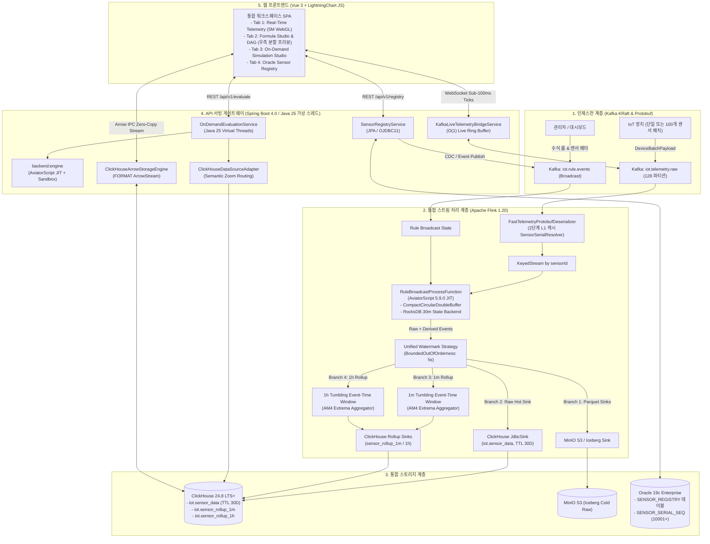

# **Spec 005: Formula Evaluator Service Integration & Unified Telemetry Platform**

> * **상태 (Status)**: 계획 확정 (Approved for Implementation)  
> * **목적지 (Destination)**: `Map #21` 결과물  
> * **관련 ADR**: [ADR-002: Formula Evaluator Service의 Realtime Data Service 통합 아키텍처](../adr/0002-formula-evaluator-merger-architecture.md)  
> * **주요 기술**: Java 25, Spring Boot 4.0.0 (Virtual Threads), Apache Flink 1.20, ClickHouse 24.8 LTS+, Oracle 19c EE, AviatorScript 5.9.0 JIT, Vue 3 + LightningChart JS

---

## **1. 아키텍처 개요 (System Architecture)**

본 명세서는 `formula-evaluator-service`의 동적 수식 평가 엔진(AviatorScript JIT, RocksDB 30분 슬라이딩 윈도우, Broadcast State, 온디멘드 평가)을 `realtime-data-service`의 고성능 인프라(Protobuf, ClickHouse 5M 롤업, Java 25 가상 스레드, WebGL 시각화)에 완전히 병합하기 위한 종합 구현 청사진이다.



---

## **2. 멀티 모듈 구성 (Module Boundaries)**

프로젝트는 명확한 관심사 분리를 위해 3개의 백엔드 모듈과 1개의 프론트엔드 모듈로 구성된다.

| 모듈 경로 | 유형 | 주요 기술 | 책임 및 구성 |
| :--- | :--- | :--- | :--- |
| **`backend:engine`** | Java Library | Java 25, AviatorScript 5.9.0 (`io.github.aviatorscript:aviator:5.9.0`) | 순수 수식 컴파일러, `ExpressionValidator`(AST 화이트리스트 샌드박스), 윈도우 함수(`window_avg`, `window_max`), 도메인 엔티티(`DynamicRule`, `SensorItem`). **Spring 의존성 없음**. |
| **`backend:pipeline`**| Flink Job | Flink 1.20, RocksDB JNI, Protobuf | 통합 Flink 스트리밍 토폴로지. Protobuf 디코더, 2단계 `SensorSerialResolver`, AviatorScript 룰 브로드캐스트 프로세서, 이중 싱크. |
| **`backend:gateway`** | Spring Boot App| Spring Boot 4.0, Java 25 Virtual Threads, OJDBC11 | Oracle JPA 센서 레지스트리, 카프카 이벤트 발행기, 온디멘드 수식 평가 REST API, ClickHouse 제로 카피 Arrow 스트리머, WebSocket 라이브 테일 브릿지. |
| **`frontend`** | Web App | Vue 3, LightningChart JS, Flechette | 탭 기반 워크스페이스 SPA. 실시간 5M WebGL 렌더링, 수식 에디터/DAG/우측 분할 프리뷰, 온디멘드 시뮬레이터, 센서 레지스트리 관리. |

---

## **3. 데이터베이스 스키마 명세 (Database Schemas)**

### **3.1. ClickHouse DDL (시계열 원시, 파생 및 사전 집계 롤업)**

```sql
-- 1. 원시 및 파생 센서 시계열 테이블 (ReplacingMergeTree + TTL 30일)
CREATE TABLE IF NOT EXISTS iot.sensor_data (
    sensor_id UInt32 CODEC(DoubleDelta, LZ4),
    ts DateTime64(3, 'UTC') CODEC(DoubleDelta, LZ4),
    v Float64 CODEC(Gorilla, ZSTD),
    s UInt8 DEFAULT 0 CODEC(T64, ZSTD),
    is_derived UInt8 DEFAULT 0 CODEC(T64, ZSTD),
    created_at DateTime DEFAULT now() CODEC(DoubleDelta, LZ4)
) ENGINE = ReplacingMergeTree(created_at)
PARTITION BY toYYYYMM(ts)
PRIMARY KEY (sensor_id, ts)
ORDER BY (sensor_id, ts)
TTL ts + INTERVAL 30 DAY DELETE
SETTINGS index_granularity = 8192;

-- 2. 1분 AM4 텀블링 롤업 테이블
CREATE TABLE IF NOT EXISTS iot.sensor_rollup_1m (
    sensor_id UInt32 CODEC(DoubleDelta, LZ4),
    bucket_ts DateTime CODEC(DoubleDelta, LZ4),
    first_v Float64, first_ts DateTime64(3, 'UTC'),
    last_v Float64, last_ts DateTime64(3, 'UTC'),
    min_v Float64, min_ts DateTime64(3, 'UTC'),
    max_v Float64, max_ts DateTime64(3, 'UTC'),
    cnt UInt32,
    avg_v Float64
) ENGINE = ReplacingMergeTree()
PARTITION BY toYYYYMM(bucket_ts)
PRIMARY KEY (sensor_id, bucket_ts)
ORDER BY (sensor_id, bucket_ts)
TTL bucket_ts + INTERVAL 180 DAY DELETE;

-- 3. 1시간 AM4 텀블링 롤업 테이블
CREATE TABLE IF NOT EXISTS iot.sensor_rollup_1h (
    sensor_id UInt32 CODEC(DoubleDelta, LZ4),
    bucket_ts DateTime CODEC(DoubleDelta, LZ4),
    first_v Float64, first_ts DateTime64(3, 'UTC'),
    last_v Float64, last_ts DateTime64(3, 'UTC'),
    min_v Float64, min_ts DateTime64(3, 'UTC'),
    max_v Float64, max_ts DateTime64(3, 'UTC'),
    cnt UInt32,
    avg_v Float64
) ENGINE = ReplacingMergeTree()
PARTITION BY toYYYYMM(bucket_ts)
PRIMARY KEY (sensor_id, bucket_ts)
ORDER BY (sensor_id, bucket_ts)
TTL bucket_ts + INTERVAL 730 DAY DELETE;
```

### **3.2. Oracle 19c Enterprise DDL (메타데이터 및 전역 일련번호 시퀀스)**

```sql
-- 1. 센서 일련번호 생성 시퀀스 (10001부터 시작, 성능 최적화 CACHE 1000)
CREATE SEQUENCE SENSOR_SERIAL_SEQ
    START WITH 10001
    INCREMENT BY 1
    NOCYCLE
    CACHE 1000;

-- 2. 통합 센서 레지스트리 테이블
CREATE TABLE SENSOR_REGISTRY (
    SERIAL_NUMBER       NUMBER(19) NOT NULL,
    SENSOR_CODE         VARCHAR2(64) NOT NULL,
    SENSOR_NAME         VARCHAR2(128) NOT NULL,
    SENSOR_TYPE         VARCHAR2(20) NOT NULL,
    CATEGORY            VARCHAR2(64),
    UNIT                VARCHAR2(32),
    DEVICE_ID           VARCHAR2(64),
    DEVICE_SENSOR_INDEX NUMBER(10),
    FORMULA_EXPRESSION  VARCHAR2(1000),
    DESCRIPTION         VARCHAR2(500),
    STATUS              VARCHAR2(20) DEFAULT 'ACTIVE' NOT NULL,
    CREATED_AT          TIMESTAMP DEFAULT CURRENT_TIMESTAMP NOT NULL,
    UPDATED_AT          TIMESTAMP DEFAULT CURRENT_TIMESTAMP NOT NULL,
    CONSTRAINT PK_SENSOR_REGISTRY PRIMARY KEY (SERIAL_NUMBER),
    CONSTRAINT UK_SENSOR_CODE UNIQUE (SENSOR_CODE),
    CONSTRAINT UK_DEVICE_SENSOR UNIQUE (DEVICE_ID, DEVICE_SENSOR_INDEX)
);

CREATE INDEX IDX_SENSOR_REGISTRY_SEARCH ON SENSOR_REGISTRY(SENSOR_TYPE, DEVICE_ID, STATUS);
```

---

## **4. 데이터 프로토콜 명세 (Protobuf)**

`proto/telemetry.proto`:
```protobuf
syntax = "proto3";

package com.telemetry.proto;

option java_package = "com.telemetry.proto";
option java_multiple_files = true;

// 1. 단일 센서 포인트 (태그 1~3 절대 불변으로 100% 하위 호환성 유지)
message TelemetryRecordProto {
  uint32 sensor_id = 1;
  int64 timestamp_ms = 2;
  double value = 3;
  
  // 확장 필드 (태그 4~7)
  uint32 state = 4;
  string device_id = 5;
  int32 sensor_index = 6;
  uint32 device_numeric_id = 7;
}

// 2. 다중 센서 고속 전송을 위한 장치 배치 페이로드 (대역폭 56.7% 절감)
message DeviceSensorMetric {
  int32 sensor_index = 1;
  double value = 2;
  uint32 state = 3;
}

message DeviceBatchPayloadProto {
  string device_id = 1;
  int64 timestamp_ms = 2;
  repeated DeviceSensorMetric metrics = 3;
}
```

---

## **5. 단계별 구현 실행 티켓 목록 (Phased Implementation Tickets)**

본 명세서가 승인된 후, 실제 구현 작업을 실행하기 위한 5개의 독립 실행 티켓 목록이다.

### **티켓 1: 공통 `backend:engine` 모듈 구축 및 AviatorScript 샌드박스 포팅**
- `formula-engine` 코드를 `backend:engine` 서브프로젝트로 이전.
- AviatorScript Maven 좌표 `io.github.aviatorscript:aviator:5.9.0` 적용 및 Spring/Lombok 의존성 배제.
- `ExpressionValidator`, `WindowAvgFunction`, `WindowMaxFunction`, `RuleEngineService`, `CompactCircularDoubleBuffer` 구현.
- Java 25 단위 테스트 통과 및 Gradle 멀티 모듈 바인딩.

### **티켓 2: Protobuf 배치 스키마 확장 및 2단계 `SensorSerialResolver` 구현**
- `proto/telemetry.proto` 확장 및 컴파일.
- 원시 `int[]` L1 캐시 기반의 `SensorSerialResolver` 구현 및 동시성 벤치마크 작성.
- Flink `FastTelemetryProtobufDeserializer` 개발 (단일/배치 자동 감지 및 멀티 레코드 언롤링).

### **티켓 3: Flink 1.20 통합 토폴로지 구축 및 RocksDB 바이트 버퍼 최적화**
- `TelemetryPipelineTopology`에 `RuleBroadcastProcessFunction` 통합.
- `CompactCircularDoubleBuffer` 기반 30분 슬라이딩 윈도우 `ValueState<byte[]>` 구현.
- 원시 및 파생 레코드 단일 워터마크 정렬, ClickHouse `JdbcSink` 적재 및 토폴로지 E2E 테스트.

### **티켓 4: `backend:gateway` Oracle 19c 레지스트리 및 ClickHouse 온디멘드 어댑터 통합**
- Spring Boot 4.0에 Oracle JPA / HikariCP 및 `SENSOR_SERIAL_SEQ` 시퀀스 연동.
- `SensorRegistryService`, `SensorRegistryController`, 카프카 변경 이벤트 발행기 통합.
- `ClickHouseDataSourceAdapter` 구현 (시맨틱 줌 라우팅: `sampleBy >= 1m` 시 롤업 테이블 조회).
- `OnDemandEvaluationService` 가상 스레드 비차단 병렬화.

### **티켓 5: 프론트엔드 통합 (Variant A 탭 워크스페이스 + 우측 분할 프리뷰)**
- `prototype/unified-frontend-navigation`의 검증된 설계를 `frontend/src`에 정식 적용.
- 실시간 LightningChart JS WebGL 캔버스와 수식/시뮬레이션/레지스트리 탭 통합.
- 수식 스튜디오의 우측 분할 라이브 프리뷰 파형 연동.
- Vitest 및 프로덕션 번들 빌드 검증.
