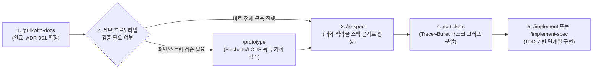
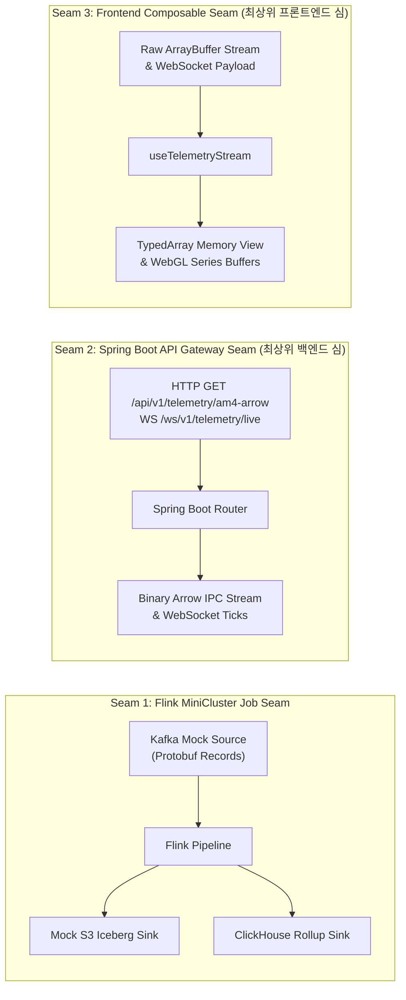
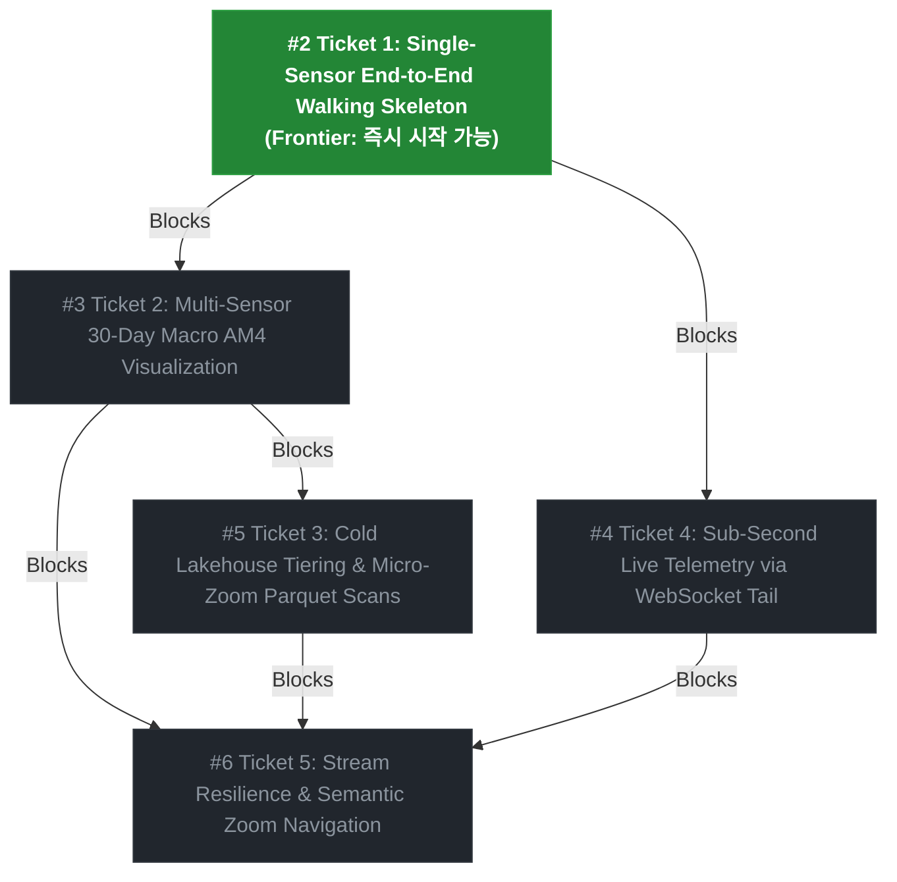
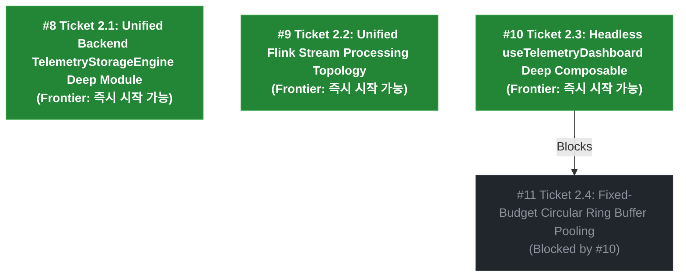

# Agent work log

0. install skills
  - matt-pocock skills
  - diagram-design
  - pstack
1. initial skills
  - /setup-matt-pocock-skills
  - /setup-pstack
2. /grill-me-with-docs @file:ADR.md
3. /ask-matt

4. /to-spec @file:ADR.md

5. /to-tickets #1

6. /ask-matt 티켓을 모두 생성했다면, 컨텍스트를 clear 해도 되나?
7. /clear
8. /implement #2
9. /retro
10. gh issue close 2
11. /clear
12. /implement #3
13. gh issue close 3 --comment "Completed multi-sensor 30-day macro AM4 visualization (commit 2dc7ed1)"
14. /clear
15. /implement #4 진행 및 결과는 한글로 출력해
16. /retro
17. gh issue close 4 --comment "Completed sub-second live telemetry via WebSocket tail with full end-to-end verification (commit 4ddc668)"
18. /clear
19. /implement #5
20. /retro
21. /clear
22. /implement #6
23. /retro
24. /improve-codebase-architecture 회고 결과를 바탕으로 개선점을 도출해
25. /to-spec 위 내용을 스펙으로 전환해 (#7)
26. /to-tickets #7

27. /clear
28. /implement #8 진행 내용은 한글로 표시해
29. /retro
