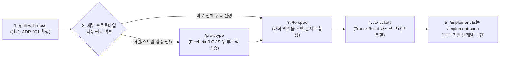
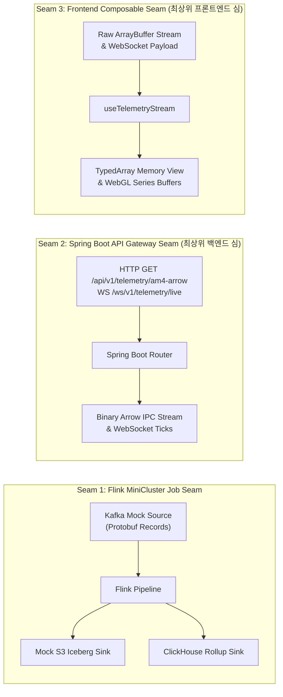

# Agent work log

0. install skills
  - matt-pocock skills
  - diagram-design
  - pstack
1. initial skills
  - /setup-matt-pocock-skills
  - /setup-pstack
2. /grill-me-with-docs @file:ADR.md
3. /ask-matt

4. /to-spec @file:ADR.md

5. /to-tickets #1
```mermaid
flowchart TD
    T1["#2 Ticket 1: Single-Sensor End-to-End Walking Skeleton\n(Frontier: 즉시 시작 가능)"]:::frontier
    T2["#3 Ticket 2: Multi-Sensor Aggregation & ClickHouse Rollup Sink\n(Blocked by #2)"]:::blocked
    T3["#4 Ticket 3: Flechette Zero-Copy Arrow Ingestion & Circular Buffer Pooling\n(Blocked by #2)"]:::blocked
    T4["#5 Ticket 4: Adaptive Window Sampling & Downsampling Engine\n(Blocked by #3, #4)"]:::blocked
    T5["#6 Ticket 5: Full Ingestion Stress Testing & 5,000,000 Points Verification\n(Blocked by #4)"]:::blocked

    T1 -->|Blocks| T2
    T1 -->|Blocks| T3
    T2 -->|Blocks| T4
    T3 -->|Blocks| T4
    T4 -->|Blocks| T5

    classDef frontier fill:#238636,stroke:#2ea043,color:#fff,font-weight:bold;\n    classDef blocked fill:#21262d,stroke:#30363d,color:#8b949e;
```
6. /clear
7. /implement #2
8. gh issue close 2 --comment "Completed Walking Skeleton implementation (commit cdab48e)"
9. /retro
10. /clear
11. /implement #3
12. gh issue close 3 --comment "Completed Multi-Sensor Aggregation & ClickHouse Rollup Sink (commit bb4d994)"
13. /retro
14. /clear
15. /implement #4
16. gh issue close 4 --comment "Completed Flechette Zero-Copy Ingestion & Circular Buffer Pooling (commit e436440)"
17. /retro
18. /clear
19. /implement #5
20. gh issue close 5 --comment "Completed Adaptive Window Sampling & Downsampling Engine (commit be94ca9)"
21. /retro
22. /clear
23. /implement #6
24. gh issue close 6 --comment "Completed Full Ingestion Stress Testing & 5,000,000 Points Verification (commit 1789c67)"
25. /retro
26. gh issue close 1 --comment "Completed Spec 001: 5M IoT Telemetry Pipeline & Dashboard Walking Skeleton"
27. /clear
28. /to-tickets #7
```mermaid
flowchart TD
    T8["#8 Ticket 2.1: Unified TelemetryStorageEngine Deep Module\n(Frontier: 즉시 시작 가능)"]:::frontier
    T9["#9 Ticket 2.2: Unified Flink Stream Processing Topology\n(Frontier: 즉시 시작 가능)"]:::frontier
    T10["#10 Ticket 2.3: Headless useTelemetryDashboard Deep Composable\n(Frontier: 즉시 시작 가능)"]:::frontier
    T11["#11 Ticket 2.4: Fixed-Budget Circular Buffer Pooling with Strict Memory Ceiling\n(Blocked by #10)"]:::blocked

    T10 -->|Blocks| T11

    classDef frontier fill:#238636,stroke:#2ea043,color:#fff,font-weight:bold;\n    classDef blocked fill:#21262d,stroke:#30363d,color:#8b949e;
```
29. /retro
30. gh issue close 8 --comment "Completed unified TelemetryStorageEngine deep module refactoring (commit 131a05a)"
31. /clear
32. /implement #9
33. /retro
34. gh issue close 9 --comment "Completed unified Flink stream processing topology refactoring (commit c4dcc2c)"
35. /clear
36. /implement #10
37. /retro
38. gh issue close 10 --comment "Completed headless useTelemetryDashboard deep composable (commit eddbd06)"
39. /clear
40. /implement #11
41. gh issue close 11 --comment "Completed fixed-budget circular ring buffer pooling with strict memory ceiling (commit ac5e4cd)"
42. /retro
43. gh issue close 7 --comment "Completed Spec 002: Architecture Refactoring"
44. /clear
45. /diagram-design
46. /clear
47. /to-spec @file:docs/adr/0001-5m-iot-telemetry-architecture.md (#12)
48. /to-tickets #12
```mermaid
flowchart TD
    T13["#13 Ticket 3.1: ClickHouse Live Client, Zero-Copy Arrow Pass-Through & Virtual Threads\n(Frontier: 즉시 시작 가능)"]:::frontier
    T14["#14 Ticket 3.2: Flink Standalone Job Packaging & Real Ingestion Sinks\n(Frontier: 즉시 시작 가능)"]:::frontier
    T15["#15 Ticket 3.3: Kafka-to-WebSocket Dynamic Live Tail Bridge\n(Blocked by #13)"]:::blocked
    T16["#16 Ticket 3.4: Full-Stack Docker Sandbox Environment & Smoke Verification\n(Blocked by #13, #14, #15)"]:::blocked

    T13 -->|Blocks| T15
    T13 -->|Blocks| T16
    T14 -->|Blocks| T16
    T15 -->|Blocks| T16

    classDef frontier fill:#238636,stroke:#2ea043,color:#fff,font-weight:bold;\n    classDef blocked fill:#21262d,stroke:#30363d,color:#8b949e;
```
49. /clear
50. /implement #13
51. gh issue close 13 --comment "Completed ClickHouse live client, zero-copy Arrow pass-through and virtual threads (commit 5805707)"
52. /retro
53. /clear
54. /implement #14
55. gh issue close 14 --comment "Completed Flink standalone job packaging and real ingestion sinks (commit e3048b4)"
56. /retro
57. /clear
58. /poteto-mode #15 티켓 구현해
59. gh issue close 15 --comment "Completed Kafka-to-WebSocket dynamic live tail bridge with O(1) early filter and virtual thread dispatch"
60. /retro
61. /clear
