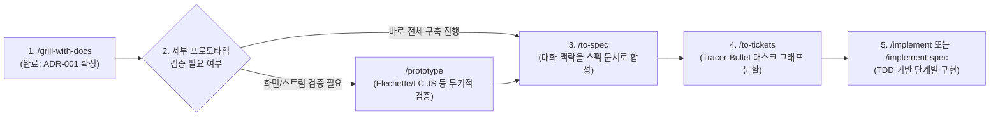
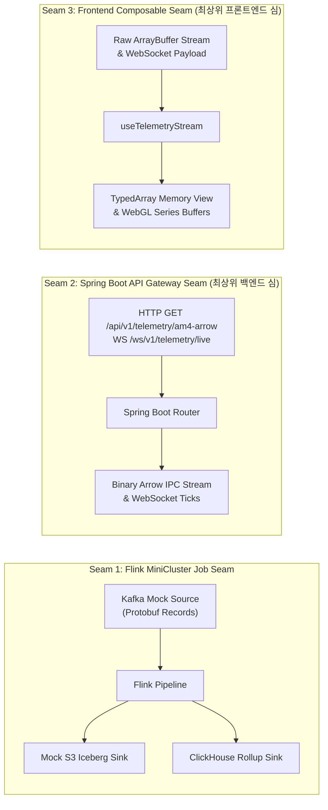
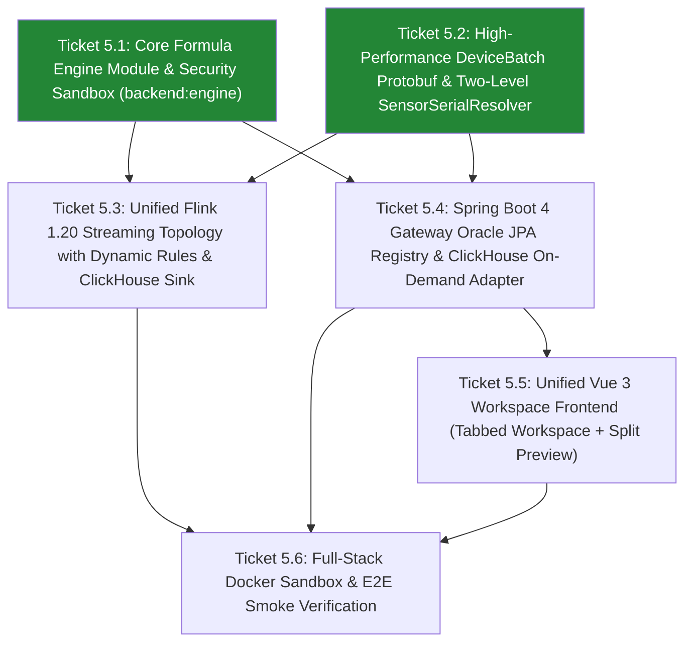
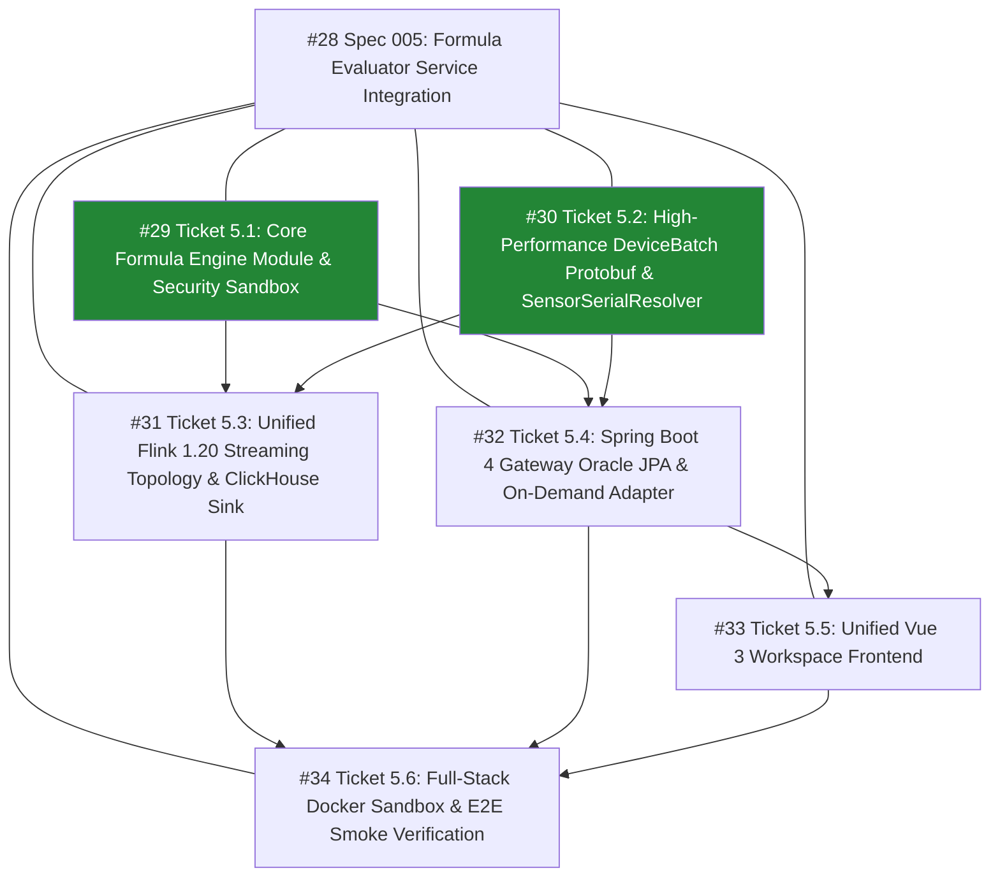

# Agent work log

## realtime  data service 구현
0. install skills
  - matt-pocock skills
  - diagram-design
  - pstack
  - 검토
    - 포니테일 (Ponytail) : 중복 개발 방지
        https://github.com/DietrichGebert/ponytail
    - 케이브맨 (Caveman) : 불필요한 출력 미사여구 방지
        https://github.com/JuliusBrussee/caveman
    - RTK : 터미널 결과 정리하여 요약
        https://github.com/rtk-ai/rtk
    - 헤드룸 (Headroom) : ai 에게 전송하기 전에 요약
        https://github.com/headroomlabs-ai/he...
    - 컨텍스트 모드 (Context Mode) : AI 외부에서 자료를 정리하여 필요한 내용만 정리
        https://github.com/mksglu/context-mode
    - 세레나 (Serena) : AI 가 고칠 함수를 바로 찾아가는 기능
        https://github.com/oraios/serena
    - 토큰 옵티마이저 (Token Optimizer) : 설정 정리
        https://github.com/alexgreensh/token-optimizer
1. initial skills
  - /setup-matt-pocock-skills
  - /setup-pstack
2. /grill-me-with-docs @file:ADR.md
3. /ask-matt

4. /to-spec @file:ADR.md

5. /to-tickets #1
```mermaid
flowchart TD
    T1["#2 Ticket 1: Single-Sensor End-to-End Walking Skeleton\n(Frontier: 즉시 시작 가능)"]:::frontier
    T2["#3 Ticket 2: Multi-Sensor Aggregation & ClickHouse Rollup Sink\n(Blocked by #2)"]:::blocked
    T3["#4 Ticket 3: Flechette Zero-Copy Arrow Ingestion & Circular Buffer Pooling\n(Blocked by #2)"]:::blocked
    T4["#5 Ticket 4: Adaptive Window Sampling & Downsampling Engine\n(Blocked by #3, #4)"]:::blocked
    T5["#6 Ticket 5: Full Ingestion Stress Testing & 5,000,000 Points Verification\n(Blocked by #4)"]:::blocked

    T1 -->|Blocks| T2
    T1 -->|Blocks| T3
    T2 -->|Blocks| T4
    T3 -->|Blocks| T4
    T4 -->|Blocks| T5

    classDef frontier fill:#238636,stroke:#2ea043,color:#fff,font-weight:bold;\n    classDef blocked fill:#21262d,stroke:#30363d,color:#8b949e;
```
6. /clear
7. /implement #2
8. gh issue close 2 --comment "Completed Walking Skeleton implementation (commit cdab48e)"
9. /retro
10. /clear
11. /implement #3
12. gh issue close 3 --comment "Completed Multi-Sensor Aggregation & ClickHouse Rollup Sink (commit bb4d994)"
13. /retro
14. /clear
15. /implement #4
16. gh issue close 4 --comment "Completed Flechette Zero-Copy Ingestion & Circular Buffer Pooling (commit e436440)"
17. /retro
18. /clear
19. /implement #5
20. gh issue close 5 --comment "Completed Adaptive Window Sampling & Downsampling Engine (commit be94ca9)"
21. /retro
22. /clear
23. /implement #6
24. gh issue close 6 --comment "Completed Full Ingestion Stress Testing & 5,000,000 Points Verification (commit 1789c67)"
25. /retro
26. gh issue close 1 --comment "Completed Spec 001: 5M IoT Telemetry Pipeline & Dashboard Walking Skeleton"
27. /clear
28. /to-tickets #7
```mermaid
flowchart TD
    T8["#8 Ticket 2.1: Unified TelemetryStorageEngine Deep Module\n(Frontier: 즉시 시작 가능)"]:::frontier
    T9["#9 Ticket 2.2: Unified Flink Stream Processing Topology\n(Frontier: 즉시 시작 가능)"]:::frontier
    T10["#10 Ticket 2.3: Headless useTelemetryDashboard Deep Composable\n(Frontier: 즉시 시작 가능)"]:::frontier
    T11["#11 Ticket 2.4: Fixed-Budget Circular Buffer Pooling with Strict Memory Ceiling\n(Blocked by #10)"]:::blocked

    T10 -->|Blocks| T11

    classDef frontier fill:#238636,stroke:#2ea043,color:#fff,font-weight:bold;\n    classDef blocked fill:#21262d,stroke:#30363d,color:#8b949e;
```
29. /retro
30. gh issue close 8 --comment "Completed unified TelemetryStorageEngine deep module refactoring (commit 131a05a)"
31. /clear
32. /implement #9
33. /retro
34. gh issue close 9 --comment "Completed unified Flink stream processing topology refactoring (commit c4dcc2c)"
35. /clear
36. /implement #10
37. /retro
38. gh issue close 10 --comment "Completed headless useTelemetryDashboard deep composable (commit eddbd06)"
39. /clear
40. /implement #11
41. gh issue close 11 --comment "Completed fixed-budget circular ring buffer pooling with strict memory ceiling (commit ac5e4cd)"
42. /retro
43. gh issue close 7 --comment "Completed Spec 002: Architecture Refactoring"
44. /clear
45. /diagram-design
46. /clear
47. /to-spec @file:docs/adr/0001-5m-iot-telemetry-architecture.md (#12)
48. /to-tickets #12
```mermaid
flowchart TD
    T13["#13 Ticket 3.1: ClickHouse Live Client, Zero-Copy Arrow Pass-Through & Virtual Threads\n(Frontier: 즉시 시작 가능)"]:::frontier
    T14["#14 Ticket 3.2: Flink Standalone Job Packaging & Real Ingestion Sinks\n(Frontier: 즉시 시작 가능)"]:::frontier
    T15["#15 Ticket 3.3: Kafka-to-WebSocket Dynamic Live Tail Bridge\n(Blocked by #13)"]:::blocked
    T16["#16 Ticket 3.4: Full-Stack Docker Sandbox Environment & Smoke Verification\n(Blocked by #13, #14, #15)"]:::blocked

    T13 -->|Blocks| T15
    T13 -->|Blocks| T16
    T14 -->|Blocks| T16
    T15 -->|Blocks| T16

    classDef frontier fill:#238636,stroke:#2ea043,color:#fff,font-weight:bold;\n    classDef blocked fill:#21262d,stroke:#30363d,color:#8b949e;
```
49. /clear
50. /implement #13
51. gh issue close 13 --comment "Completed ClickHouse live client, zero-copy Arrow pass-through and virtual threads (commit 5805707)"
52. /retro
53. /clear
54. /implement #14
55. gh issue close 14 --comment "Completed Flink standalone job packaging and real ingestion sinks (commit e3048b4)"
56. /retro
57. /clear
58. /poteto-mode #15 티켓 구현해
59. gh issue close 15 --comment "Completed Kafka-to-WebSocket dynamic live tail bridge with O(1) early filter and virtual thread dispatch"
60. /retro
61. /clear
62. /poteto-mode #16 티켓 구현해
63. gh issue close 16 --comment "Completed Full-Stack Docker Sandbox Environment & Smoke Verification"
64. /retro
65. gh issue close 12 --comment "Completed Spec 003: Production Infrastructure Binding & Live Cluster Readiness"
66. /clear
67. /to-spec Spec 004: JDK 25 & Spring Boot 4.x Migration (#17)
68. /to-tickets #17
69. /poteto-mode 프로젝트를 jdk25, springboot 4.x 기준으로 전환해
70. Completed Spec 004: JDK 25 and Spring Boot 4.1.2 migration with full test green
71. gh issue close 18 --comment "Completed Ticket 4.1: Upgrade Gradle Compilation Baseline to Java 25 (commit 4b55aa2)"
72. gh issue close 19 --comment "Completed Ticket 4.2: Upgrade Spring Boot Gateway to 4.1.2 & Spring Framework 7 (commit 4b55aa2)"
73. gh issue close 20 --comment "Completed Ticket 4.3: Update Docker Runtime to JDK 25 & Verify Smoke Tests (commit 4b55aa2)"
74. gh issue close 17 --comment "Completed Spec 004: JDK 25 & Spring Boot 4.x Migration (commit 4b55aa2)"
75. /diagram-design (Update system architecture diagram with Spec 003 & Spec 004 production changes)

## Realtime Data Service 기반으로 Formula evaluator service 병합
1. /wayfinder 현재 리파지토리에 C:\Users\imoil\repo\formula-evaluator-service 프로젝트의 기능을 병합하려고 해. 공통적으로 IoT 센서에 대한 1초 단위 처리를 하고 있고, flink 를 사용하고 있어. 두 프로젝트 중에서 어떤 기능을 선택하고 병합할 것인지 검토가 필요해. (Plan mode)
```

▸ Thought for 32s, 3.8k tokens

  /wayfinder를 통해 두 프로젝트의 기능을 분석하고, 병합(Merge) 의사결정을 위한 맵을 작성하는 과정을 시작하겠습니다.

  두 프로젝트의 코드베이스를 사전 분석한 결과:

  • realtime-data-service (현재 Repo):
      • Java 25, Spring Boot 4.x (가상 스레드), Flink 1.20, Protobuf, Kafka KRaft.
      • 저장소: ClickHouse (1m/1h 롤업 및 ArrowStream 제로 카피 서빙) + MinIO/Iceberg (원시 콜드 데이터).
      • 프론트엔드: Vue 3 + LightningChart JS (WebGL 500만 포인트 실시간 렌더링) + Flechette Arrow 역직렬화.
  • formula-evaluator-service:
      • Java 25, Spring Boot 3.5.x, Flink 1.19.3, AviatorScript 5.9.0 JIT, Kafka 3.9.
      • 핵심 기능: 동적 룰/수식 평가 엔진(샌드박스 보안, RocksDB 30분 슬라이딩 윈도우, Broadcast State), 온디멘드 시뮬레이션 경로, SensorSerialResolver (단일 일련번호 매핑).
      • 저장소: QuestDB (ILP 싱크 및 PGWire 쿼리) + Oracle 19c (센서 레지스트리 메타데이터).
      • 프론트엔드: Vue 3 + Vuetify 4 (수식 DAG 에디터, 센서 관리, 온디멘드 시뮬레이션).


  목적지(Destination)를 명확히 고정하고 미지의 영역(Frontier)을 구체화하기 위해, Grilling Round 1 질문을 드립니다. 각 질문은 "네(Yes)"라고 답하시면 권장 답변을 채택하도록 구성되어 있습니다.
  ──────
  ❓ Q1 - 최종 목적지(Destination) 범위 정의:
  이번 Wayfinding의 최종 목적지를 **"두 프로젝트 간 중복 기술을 단일화하고, formula-evaluator-service의 동적 수식 평가 엔진 및 온디멘드 경로를 realtime-data-service 아키텍처에 통합하기 위한 세부 아키텍처 명세서(Spec) 및 의사결정 기록(ADR) 도출"**로 정의하는 것이
  맞습니까? (실제 코드 구현 단계는 이 명세서가 완성된 후 별도 실행 세션으로 분리합니다.)

  ➡️ 네(Recommended): 구현에 바로 착수하기 전에, 컴포넌트별 선택 기준(Storage, Stream Topology, Data Contract, Gateway, UI)과 통합 인터페이스를 명확히 결정하고 문서화하는 것을 목적지로 설정합니다.
  ──────
  ❓ Q2 - 시계열 및 메타데이터 저장소 단일화 (Storage Strategy):
  시계열 데이터 저장소로 realtime-data-service의 **ClickHouse + MinIO(Iceberg)**를 표준으로 채택하고, formula-evaluator-service의 QuestDB(ILP Sink 및 어댑터)는 폐기 또는 ClickHouse 어댑터로 대체하는 것이 맞습니까? 또한, 센서 메타데이터(레지스트리)는 무거운 Oracle 19c 의존성을 제거하고 경량 RDBMS(PostgreSQL 또는 ClickHouse 테이블/SQLite)로 전환하는 것을 목표로 검토할까요?

  ➡️ 네(Recommended): ClickHouse는 이미 5M 포인트 Arrow 스트리밍 및 롤업에 최적화되어 있으므로, 굳이 QuestDB를 이중 운영하지 않고 ClickHouse로 단일화합니다. Oracle 19c 역시 로컬 샌드박스 및 운영 복잡도를 낮추기 위해 PostgreSQL/ClickHouse 메타 테이블로 전환하는 방향을 추천합니다.
  ──────
  ❓ Q3 - Flink 파이프라인 통합 흐름 (Stream Topology):
  통합 Flink 파이프라인의 처리 순서를 다음과 같이 단일 토폴로지로 연결하는 구조로 설계할까요?
  원시 센서 스트림 + 동적 룰 Broadcast ➔ AviatorScript 수식 평가 (RocksDB 슬라이딩 윈도우) ➔ [원시 센서 + 파생 센서 이벤트] ➔ 1분/1시간 텀블링 윈도우 롤업 ➔ ClickHouse & Iceberg 이중 싱크

  ➡️ 네(Recommended): 수식을 통해 계산된 파생 센서(Derived Sensor) 데이터도 원시 데이터와 동일한 1초 주기 시계열이므로, 수식 평가를 거친 후 원시/파생 센서가 모두 1분/1시간 롤업 및 저장소 싱크를 공유하는 단일 토폴로지가 가장 일관성 있고 확장성이 높습니다.
  ──────
  ❓ Q4 - 센서 식별 체계 및 데이터 프로토콜 통합 (Data Contract):
  네트워크 전송 성능을 위해 realtime-data-service의 Protobuf 바이너리 포맷을 기본 전송 포맷으로 유지하되, formula-evaluator-service의 핵심 장점인 **SensorSerialResolver (장치 ID + 장치 내부 센서 인덱스를 전역 고유 식별자로 치환하는 체계)**를 Protobuf 스키마 및 인제스천 레이어에 흡수시키는 방식으로 통합할까요?

  ➡️ 네(Recommended): 수백만 대 센서의 1초 주기 처리를 위해서는 JSON보다 Protobuf가 압도적으로 유리합니다. 대신 formula-evaluator의 단일 일련번호 충돌 방지 로직(SensorSerialResolver)을 Protobuf 디코더/매핑 레이어에 통합하여 두 장점을 모두 취합니다.
  ──────
  ❓ Q5 - 게이트웨이 및 프론트엔드 UI 통합 (Gateway & UI):
  백엔드 게이트웨이는 Spring Boot 4.x(Java 25 Virtual Threads) 기반의 backend/gateway로 단일화하고, 프론트엔드는 기존 LightningChart JS 초고속 차트 대시보드에 formula-ui의 기능(수식 편집기/DAG 뷰, 온디멘드 시뮬레이션 스튜디오, 센서 등록 관리)을 다중 탭/라우트로 결합하는 것이 맞습니까?

  ➡️ 네(Recommended): 백엔드는 최신 Spring Boot 4.x 가상 스레드 환경으로 formula-api의 온디멘드 평가 엔드포인트를 흡수하고, 프론트엔드는 실시간 렌더링 뷰와 수식 관리 뷰를 하나의 SPA로 결합합니다.
  ──────
  각 질문에 대해 "네" 또는 수정/보완하고 싶으신 의견을 말씀해 주시면, 이를 반영하여 Wayfinder Map 이슈와 Decision 티켓들을 생성하고 분석을 진행하겠습니다.

 /plan 모두 수용

○ Thought for 1m 28s (Examining the project structure reveals distinct front-end and real-time data service components, utilizin...)
● Ran (gh --version)
● Explored 8 files (TelemetryPipelineTopology.java, StreamingEvaluatorJob.java, RuleBroadcastProcessFunction.java, +5)
● Edited 1 file (wayfinder-merge-plan.md) (ctrl+o to expand)

▸ Thought for 4s, 203 tokens

  /wayfinder 맵 차팅 및 병합 계획을 위한 구현 계획서(wayfinder-merge-plan.md) 작성을 완료했습니다.

  ### 주요 포함 내용

  • 최종 목적지(Destination) 및 범위: 두 프로젝트 간 중복 의존성(QuestDB, Oracle 19c)을 정리하고, 동적 수식 평가 엔진(AviatorScript, RocksDB 슬라이딩 윈도우)을 ClickHouse/Protobuf 기반 실시간 파이프라인에 통합하기 위한 통합 아키텍처 명세서(Spec) 및 ADR 도출.
  • GitHub 이슈 계층 구조:
      • wayfinder:map: 부모 맵 이슈
      • T1 ~ T3 (Research, AFK): ClickHouse 대체, Flink 1.20 토폴로지 통합, Protobuf + SensorSerialResolver 조사
      • T4 ~ T6 (Grilling / Prototype, HITL): 센서 레지스트리 DB 결정, 게이트웨이 API 통합, 프론트엔드 통합 레이아웃 프로토타입
  • 의존성 그래프 및 연구 서브에이전트 실행 전략

  계획서를 검토하신 후 승인(Proceed)해 주시면, GitHub Issues에 맵 및 티켓들을 생성하고 Research 서브에이전트 조사를 병렬로 즉시 시작하도록 하겠습니다.

Oracle 19c 의존성을 완전히 걷어내고, 센서 메타데이터 및 단일 일련번호(serialNumber: 10001+), 동적 수식 룰을 관리하기 위한 저장소 의사결정을 위해 Grilling 질문을 드립니다. 각 질문은 "네(Yes)"라고 답하시면 권장 답변을 채택하도록 구성되어 있습니다.
  ──────
  ❓ Q1 - 센서 레지스트리 메타데이터 저장소로 PostgreSQL 16 채택:
  무거운 Oracle 19c(메모리 2GB+, 독점 라이선스)를 제거하고, 표준 RDBMS인 PostgreSQL 16(경량 Docker 컨테이너, 약 50MB 메모리)을 SENSOR_REGISTRY 및 룰 메타데이터 저장소로 채택하는 것이 맞습니까? (ClickHouse는 OLTP 트랜잭션 및 즉각적인 단건 CRUD에 부적합하므로 메타데이터 저장소로 분리 운영)

  ➡️ 네(Recommended): Spring Boot 4 x / Spring Data JPA 및 Flyway 마이그레이션과의 완벽한 호환성, 복합 고유키 제약조건((device_id, device_sensor_index) UNIQUE), ACID 트랜잭션 보장, 로컬 샌드박스 Docker Compose 경량화를 위해 PostgreSQL 16을 표준으로 채택합니다.
  ──────
  ❓ Q2 - 일련번호 시퀀스 및 수식 키 하위 호환성 유지:
  PostgreSQL의 네이티브 시퀀스(CREATE SEQUENCE sensor_serial_seq START WITH 10001 INCREMENT BY 1)를 사용하여 물리 센서 및 수식 센서의 일련번호를 기존 10001부터 발급하고, 수식 엔진의 변수 식별자 규칙(SN_10001, 10001)을 그대로 유지하는 것이 맞습니까?

  ➡️ 네(Recommended): 기존에 작성된 AviatorScript 수식 표현식(SN_10001 * 0.8 + SN_10002 * 0.2)과의 일관성을 유지하고, 티켓 #24에서 연구된 고속 SensorSerialResolver(원시 int[] 직렬 매핑)와의 정수 인덱싱 호환성을 위해 10001 기반 순차 시퀀스를 유지합니다.
  ──────
  ❓ Q3 - 메타데이터 변경 이벤트 전파 (Event-Driven Resolver Sync):
  SensorRegistryService에서 신규 센서 등록/수정/동기화 또는 동적 수식 룰 생성/수정이 발생할 때, Kafka
  토픽(iot.sensor.registry.events 및 iot.rule.events)으로 변경 이벤트를 발행하여 Flink 클러스터의 Broadcast State와 **Gateway의 메모리 캐시(SensorSerialResolver)**가 재부팅 없이 실시간으로 동기화되도록 설계하는 것이 맞습니까?

  ➡️ 네(Recommended): Flink 스트리밍 워커와 게이트웨이 인스턴스들이 데이터베이스 폴링 없이 무중단(Zero-downtime)으로 신규 장치 및
  수식 룰을 즉각 인식할 수 있도록 카프카 이벤트 기반 전파 아키텍처를 적용합니다.
  ──────
  각 질문에 대해 "네" 또는 수정/보완하고 싶으신 의견을 말씀해 주시면, 결정을 확정하고 #25 https://github.com/imoil/realtime-data-
  service/issues/25 티켓을 해결하도록 하겠습니다.

────────────────────────────────────────────────────────────
> Q1. 이미 운영 환경에서 오라클을 사용 중이므로, RDBMS가 필요한 상황이면 오라클을 그대로 유지하도록 해. 나머지 질문은 제안 사항을 승인해.


▸ Thought for 13s, 1.2k tokens

  티켓 #25 https://github.com/imoil/realtime-data-service/issues/25의 결정사항(운영 환경 오라클 19c 유지, SENSOR_SERIAL_SEQ: 10001+ 유지, 카프카 이벤트 기반 실시간 동기화)을 반영하여 해결 및 종료하였습니다.

  이에 따라 #25 https://github.com/imoil/realtime-data-service/issues/25에 의해 차단되어 있던 **티켓 #26 https://github.com/imoil/realtime-data-service/issues/26**가 언블락되어 Frontier로 진입하였으며, 티켓을 클레임(Assigned)하였습니다.
  ──────
  ### Frontier 티켓 작업: #26 Decision: Gateway API integration and On-Demand Evaluation service architecture
  https://github.com/imoil/realtime-data-service/issues/26 (wayfinder:grilling)

  formula-evaluator-service의 핵심 서비스들(온디멘드 수식 평가, 센서 등록 관리, 수식 엔진)을 realtime-data-service의 Spring Boot 4.x(Java 25 가상 스레드) 게이트웨이에 통합하는 방식을 결정하기 위해 Grilling 질문을 드립니다. 각 질문은 "네(Yes)"라고 답하시면 권장 답변을 채택하도록 구성되어 있습니다.
  ──────
  ❓ Q1 - 백엔드 멀티 모듈 및 패키지 구조 분리 (backend:engine):
  수식 파싱, 샌드박스 보안 검증(ExpressionValidator), AviatorScript 컴파일러 및 윈도우 함수(window_avg, window_max)를 담당하는 로직을 독립 모듈 backend:engine(Java 라이브러리)으로 분리하여, **backend:pipeline (Flink 스트리밍 잡)**과 backend:gateway (온디멘드 평가 REST API) 양쪽에서 공통 라이브러리로 참조하도록 구성하고, REST 컨트롤러 및 Oracle JPA 레지스트리는 backend:gateway 내부로 흡수시키는 것이 맞습니까?

  ➡️ 네(Recommended): Flink 클러스터 워커와 게이트웨이 서비스가 동일한 수식 평가 컴파일러 및 보안 검증 로직을 단일 코드베이스로 공유하면서도, 스프링 컨텍스트 의존성 없이 Flink 워커에 경량으로 배포할 수 있는 가장 깔끔한 관심사 분리(SoC) 구조입니다.
  ──────
  ❓ Q2 - Java 25 가상 스레드(Virtual Threads) 기반 온디멘드 동시성 처리:
  backend:gateway의 온디멘드 수식 평가 서비스(OnDemandEvaluationService)가 사용자의 대량 시계열 기간 조회 요청을 처리할 때, Java 25 가상 스레드를 활용하여 ClickHouse로부터 시간대별 블록 데이터를 비차단(Non-blocking) 병렬로 조회하고 AviatorScript JIT 평가를 가상 스레드 풀에서 동시 처리하도록 설계하는 것이 맞습니까?

  ➡️ 네(Recommended): Spring Boot 4.x의 가상 스레드(spring.threads.virtual.enabled=true)를 통해 OS 플랫폼 스레드 점유 없이 수백 명의 동시 사용자가 복잡한 30일 구간 수식 시뮬레이션을 요청하더라도 지연 없이 고성능으로 처리할 수 있습니다.
  ──────
  ❓ Q3 - ClickHouse 기반 온디멘드 데이터 어댑터 및 시맨틱 줌 라우팅:
  QuestDB 어댑터를 대체할 ClickHouseDataSourceAdapter를 구현할 때, 요청된 샘플링 단위(sampleBy)에 따라 기존 게이트웨이의 시맨틱 줌 라우터(TelemetryQueryRouter)와 동일한 지능형 라우팅을 적용하는 것이 맞습니까? (예: sampleBy >= 1m인 경우 원시 테이블 전체 스캔 대신 sensor_rollup_1m / sensor_rollup_1h 롤업 테이블을 조회하여 50배 이상 응답 속도 단축)

  ➡️ 네(Recommended): 원시 초 단위 데이터를 매번 전체 스캔하지 않고 기 집계된 롤업 테이블을 적응적으로 활용함으로써, 수식 시뮬레이션 및 과거 이력 검증 화면의 응답 시간을 수백 밀리초(Sub-second) 이내로 유지할 수 있습니다.
  ──────
  각 질문에 대해 "네" 또는 수정/보완하고 싶으신 의견을 말씀해 주시면, 결정을 확정하고 #26 https://github.com/imoil/realtime-data-service/issues/26 티켓을 해결하도록 하겠습니다.

─────────────────────────────────────────────────────────────────────────────────────────────────────────────────────────────────────
> 모두 승인

### 1. 핵심 확정 산출물

  1. **ADR-002: Formula Evaluator Service의 Realtime Data Service 통합 아키텍처**
      • ClickHouse 단일화 및 QuestDB 컨테이너 퇴역 결정
      • Flink 1.20 단일 파이프라인 (동적 수식 평가 → 1분/1시간 텀블링 롤업 → 이중 싱크)
      • Protobuf 배치 스키마 및 2단계 L1 캐시 기반 SensorSerialResolver (2ns 미만 L1 조회, 힙 할당 0건)
      • 기존 운영 환경과의 일관성을 위한 Oracle 19c 메타데이터 및 SENSOR_SERIAL_SEQ (10001+) 유지
      • Spring Boot 4.0 가상 스레드 및 backend:engine 공통 라이브러리 분리
      • Tabbed Industrial Workspace + 우측 분할 라이브 프리뷰 채택
  2. **Spec 005: Formula Evaluator Service Integration & Unified Telemetry Platform**
      • 전체 통합 시스템 아키텍처 다이어그램 (Mermaid)
      • 멀티 모듈 경계 (backend:engine, backend:pipeline, backend:gateway, frontend)
      • ClickHouse 및 Oracle 19c 정식 DDL 정의
      • Protobuf DeviceBatchPayload 스키마 (카프카 인그레스 대역폭 56.7% 절감)
      • 단계별 실행 티켓 5건 정의 (티켓 1~티켓 5)
  3. **GLOSSARY.md**
      • 물리 센서, 수식/파생 센서, 전역 일련번호, SensorSerialResolver, 텀블링 롤업 vs 슬라이딩 윈도우 등 표준 도메인 용어 정의
  4. 검증된 UI 프로토타입 브랜치
      • 브랜치: prototype/unified-frontend-navigation https://github.com/imoil/realtime-data-service/tree/prototype/unified-
      frontend-navigation
      • 선택하신 Variant A(상단 탭 바) + 우측 분할 라이브 프리뷰 구현 및 Vitest 테스트 24건 통과 완료

  ──────
  ### 2. 향후 구현 단계 (Next Steps)

  설계와 방향이 모두 명확해졌으므로, 실제 구현 착수 시 Spec 005의 단계별 구현 티켓을 순차적으로 발행하여 AFK 에이전트 또는 페어
  프로그래밍으로 개발을 진행하실 수 있습니다.
```
2. /ask-matt
```
/ask-matt 이후 단계를 설명

▸ Thought for 10s

  ask-matt 워크플로우에 따른 **현재 위치와 이후 진행 단계(Next Steps)**에 대해 설명드리겠습니다.
  ──────
  ### 1. 현재 우리의 위치

  │ Diagram exceeds terminal width (208 > 132 cols)
  │ Displayed as code block. Widen terminal to view inline.

    flowchart LR
        A["아이디어 (Fog)"] --> B["/wayfinder (On-ramp)"]
        B --> C["의사결정 완료 (ADR-002, Spec 005)"]
        C -->|Main Flow 합류| D["/to-tickets (티켓 분할)"]
        D --> E["/implement 또는 /implement-spec"]
        E --> F["/code-review & /pr"]
        F --> G["/retro (회고)"]

        style B fill:#1f6feb,color:#fff
        style C fill:#238636,color:#fff
        style D fill:#d29922,color:#fff

  • 지금까지 우리는 On-ramp 단계인 **/wayfinder**를 통해 안개 속에 있던 거대한 요구사항을 분석하고, 모든 기술적 검증(ClickHouse,
  Flink 1.20, Protobuf)과 의사결정(Oracle 19c 유지, 게이트웨이 및 프론트엔드 프로토타입)을 마쳐 **ADR-002** 및 **Spec 005**로
  구체화했습니다.
  • wayfinder의 철학은 **"계획(Planning)이지 실행(Build)이 아니다"**이므로, 맵이 완료된 지금 메인 플로우(Main Flow)로 합류하여
  구현 단계로 진입하게 됩니다.
  ──────
  ### 2. 이후 진행 단계

  #### Step 1. 티켓 분할 (/to-tickets)

  • 수행 내용: Spec 005의 5개 구현 항목을 GitHub Issues에 Tracer-bullet 티켓으로 정식 등록하고, 상호 간의 의존성(Blocking edges)을
  연결합니다.
      • 티켓 1: 공통 backend:engine 모듈 구축 및 AviatorScript 샌드박스 포팅
      • 티켓 2: Protobuf 배치 스키마 확장 및 2단계 SensorSerialResolver 구현
      • 티켓 3: Flink 1.20 통합 토폴로지 구축 및 RocksDB 바이트 버퍼 최적화 (Blocked by 티켓 1, 2)
      • 티켓 4: backend:gateway Oracle 19c 레지스트리 및 ClickHouse 온디멘드 어댑터 통합 (Blocked by 티켓 1, 2)
      • 티켓 5: 프론트엔드 통합 (Variant A 탭 워크스페이스 + 우측 분할 프리뷰) (Blocked by 티켓 4)

  ──────
  #### Step 2. 빌드 실행 (2가지 실행 방식 중 선택)

  티켓 그래프가 생성되면 다음 두 가지 방식 중 하나로 구현을 시작합니다:

  • 옵션 A: 순차적 대화형 개발 (/implement per ticket)
      • 의존성이 풀린 첫 번째 티켓부터 하나씩 차례대로 구현합니다.
      • 각 티켓마다 **/tdd (Red-Green-Refactor)**로 단위/통합 테스트를 먼저 작성하고 코드를 작성하며, 완료 후 **/code-review**를
      수행합니다.
      • 컨텍스트 오염을 방지하기 위해 티켓과 티켓 사이에 /clear로 세션을 분리합니다.
  • 옵션 B: 일괄 자동화 오케스트레이션 (/implement-spec)
      • 명세서 전체를 한 번에 구축할 때 사용합니다.
      • 의존성 그래프의 Frontier(준비된 티켓)를 분석하여 서브에이전트들이 병렬로 /tdd 구현을 진행하고, 통합
      브랜치(integration/*)에 모은 뒤 한 번에 /code-review를 실행합니다.

  ──────
  #### Step 3. 배포 및 풀 리퀘스트 (/pr)

  • 구현 브랜치 검증이 완료되면, 변경 증거(Before/After, 테스트 결과)를 포함한 정형화된 PR 본문을 작성하여 PR을 생성합니다.
  ──────
  #### Step 4. 세션 회고 (/retro)

  • 대규모 통합 작업이 끝난 후, 에이전트의 개발 환경(린트 룰, 코딩 스탠다드, CI 자동화 점검, AGENTS.md 등)을 개선하기 위한 회고를
  진행합니다.
  ──────
  ### 다음 추천 액션

  지금 바로 다음 단계인 **/to-tickets**를 실행하여 Spec 005를 GitHub 이슈 트래커의 구현 티켓들로 발행할 수 있습니다. 진행을
  원하시면 말씀해 주세요!
```
3. /to-tickets

  - 티켓 발행

4. /clear
5. /poteto-mode gh issues #29를 구현해. 구현이 끝나면 PR을 올린 후 자동 병합이 가능하면 자동 병합하고 자동 병합이 불가능하면 알려줘. 자동 병합 후에는 구현된 이슈 티켓은 Close 해줘. 전체 spec은 issue #28을 참고해. 
6. /retro
```
Retro 실행 후 변경 사항은 검토 한 다음 반영해 달라고 요구하지 않으면 반영하지 않는다.
반드시 내용을 검토 후 반영 여부를 결정하여 요청하도록 한다.
```
7. 회고 제안 사항 반영:
   - 1번(임시 원본 저장소 경로) & 3번(Windows 샌드박스 실행 가이드) -> AGENTS.md
   - 2번(GitHub Actions Backend CI) -> .github/workflows/backend-ci.yml
   - 4번(AviatorScript Maven 좌표 명시) -> docs/specs/spec-005-formula-evaluator-service-merge.md & docs/adr/0002
   - 5번(상속 시 빌더 은닉 방지 및 의존성 규칙) -> CODING_STANDARDS.md
8. Issue #30 (Ticket 5.2: Protobuf 배치 스키마 확장 및 2단계 SensorSerialResolver) 구현, /code-review 수행, PR #36 자동 병합 및 이슈 종료 완료.
